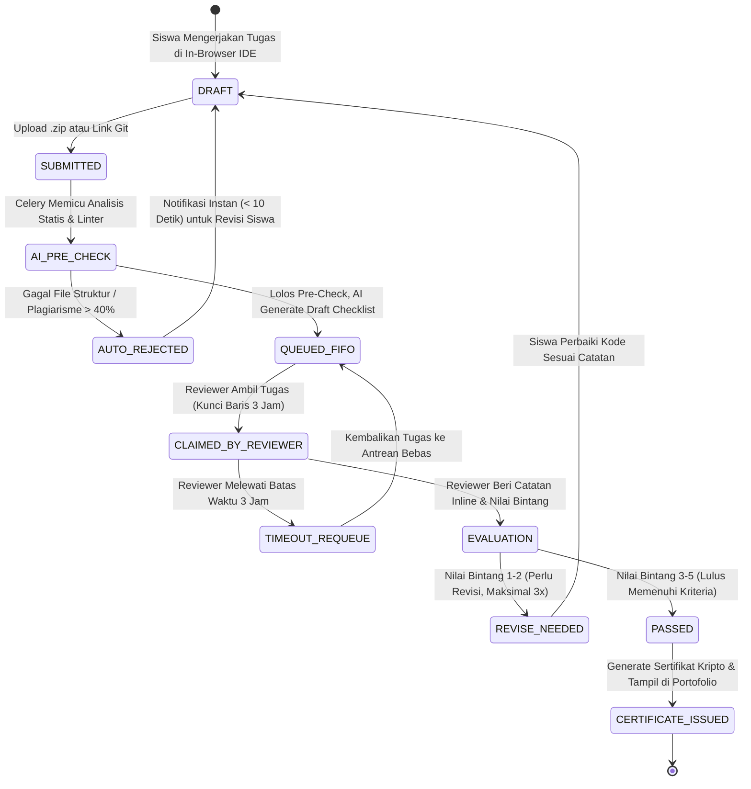

# LMS System Analyst Skill (Competency-Based Education Architect)

Panduan keahlian dan runbook sistem analis untuk **Platform LMS Berbasis Kompetensi & Akselerasi Talenta Digital** (seperti Dicoding.com generasi baru). Keahlian ini mencakup analisis proses bisnis pembelajaran aktif (*active learning*), pemodelan alur evaluasi kode manusia dan AI (*dual-engine review*), spesifikasi prasyarat alur belajar (*learning paths*), pencegahan kecurangan/joki, serta pemetaan kontrak API antara backend Python FastAPI dan frontend Next.js.

---

## 1. Topologi Arsitektur Ekosistem LMS

```
                                  [ PENGGUNA & INTERNET ]
                                             │
                             ┌───────────────┴───────────────┐
                             │    Cloudflare WAF / CDN & SSL │
                             └───────────────┬───────────────┘
                                             │
                             ┌───────────────┴───────────────┐
                             │   Nginx Reverse Proxy Gateway │
                             └───────────────┬───────────────┘
                                             │
             ┌───────────────────────────────┼───────────────────────────────┐
             ▼                               ▼                               ▼
    ┌─────────────────┐             ┌─────────────────┐             ┌─────────────────┐
    │  Learner Portal │             │ Reviewer Studio │             │ Hiring Hub & B2B│
    │   (Next.js 15)  │             │   (Next.js 15)  │             │   (Next.js 15)  │
    │  Reader & Cloud │             │ Inline Code &   │             │ Talent Search & │
    │       IDE       │             │ Rubric Scoring  │             │ Enterprise Rep. │
    └────────┬────────┘             └────────┬────────┘             └────────┬────────┘
             │                               │                               │
             └───────────────────────────────┼───────────────────────────────┘
                                             │ (REST API / SSE Streams / WebSockets)
                                             ▼
                             ┌───────────────────────────────┐
                             │     Python FastAPI Core       │
                             │  (Modular Monolith / Async)   │
                             │  - Auth & RBAC Middleware     │
                             │  - Learning Path & Quizzes    │
                             │  - Submission & Review Engine │
                             │  - Event & Challenge Engine   │
                             │  - AI Socratic Orchestrator   │
                             └───────────────┬───────────────┘
                                             │
             ┌───────────────────────────────┼───────────────────────────────┐
             ▼                               ▼                               ▼
    ┌─────────────────┐             ┌─────────────────┐             ┌─────────────────┐
    │  PostgreSQL 16+ │             │   Redis Cache   │             │ MinIO / AWS S3  │
    │  - Relational   │             │  - Celery Broker│             │ - Code Zips     │
    │    ACID (3NF)   │             │  - Review Queue │             │ - Cert PDFs     │
    │  - pgvector AI  │             │  - User Session │             │ - Static Media  │
    └─────────────────┘             └────────┬────────┘             └─────────────────┘
                                             │
                                             ▼
                                    ┌─────────────────┐
                                    │  Celery Workers │
                                    │  - AI Pre-Check │
                                    │  - Linter & AST │
                                    │  - PDF Weasypr. │
                                    │  - Email/WA Not.│
                                    └─────────────────┘
```

---

## 2. Pemodelan Alur Kerja Inti (Core Business Workflows)

### 2.1 Alur Pengiriman & Penilaian Tugas (Submission Review Lifecycle)
Sistem analis wajib memastikan siklus submission terlindungi dari *race condition* dan *bottleneck*:



### 2.2 Alur Penguncian Kelas Prasyarat (Learning Path Gating Logic)
Aturan transisi status kelas dalam satu jalur belajar:
1. `LOCKED`: Kelas belum memenuhi prasyarat kelas sebelumnya.
2. `UNLOCKED`: Kelas prasyarat telah lulus dengan minimal Bintang 3 atau lulus *Placement Test* (skor > 85%).
3. `IN_PROGRESS`: Siswa telah membaca modul materi pertama.
4. `COMPLETED`: Seluruh materi, kuis (skor >= 80%), dan submission telah dinyatakan `PASSED`.

---

## 3. Format Standar Analisis Persyaratan (SRS Specification Format)

Setiap kebutuhan baru harus dianalisis dengan format baku berikut:

### Template Persyaratan Fungsional (FR)
```markdown
### FR-[DOMAIN]-[NOMOR]: [Judul Fitur Terukur]
- **Aktor:** [Siswa / Reviewer / Instruktur / Admin / Hiring Partner]
- **Kondisi Awal (Pre-Conditions):** Kondisi sistem sebelum aksi dieksekusi.
- **Pemicu (Trigger):** Aksi pengguna (klik tombol, upload berkas, atau cron scheduler).
- **Alur Utama (Main Success Scenario):**
  1. Aktor melakukan aksi X.
  2. Sistem memvalidasi payload Y.
  3. Sistem mengubah status state database ke Z secara transaksional.
  4. Sistem mengembalikan response 200/201 dan mengirimkan notifikasi asinkronus.
- **Kondisi Akhir (Post-Conditions):** Kondisi data setelah berhasil.
- **Penanganan Kondisi Gagal (Edge Cases & Exception Flows):**
  - Kasus A: Jika koneksi pihak ketiga timeout -> Mekanisme retry eksponensial 3x.
  - Kasus B: Jika terjadi race condition -> Row-level lock `SELECT ... FOR UPDATE`.
```

---

## 4. Checklist Analisis Khusus LMS (Analyst Quality Guardrails)

Sebelum mempublikasikan spesifikasi modul ke tim pengembang:
- [ ] **SLA Safety:** Apakah fitur baru submission memperlambat antrean review? (Maksimal target antrean tetap < 12 jam).
- [ ] **Anti-Plagiarism & Integrity:** Apakah kode yang dikirim divalidasi dengan algoritma kesamaan semantik AST via `pgvector`?
- [ ] **Idempotensi Transaksi:** Apakah webhook pembayaran memiliki `idempotency_key` untuk mencegah aktivasi kelas ganda saat network retry?
- [ ] **State Machine Consistency:** Apakah seluruh kemungkinan transisi status (`PENDING -> PAID -> EXPIRED`) tertutup rapat tanpa celah status menggantung?
- [ ] **Zero Data Leakage:** Apakah kueri data portofolio siswa mematuhi aturan privasi UU PDP No. 27/2022 (informasi kontak pribadi disembunyikan sampai siswa menyetujui wawancara rekruter)?
