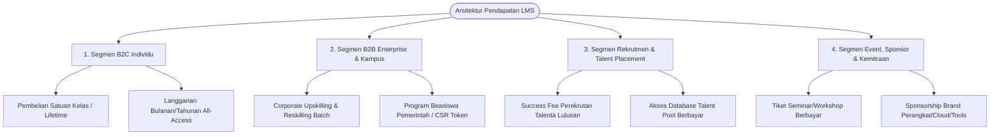
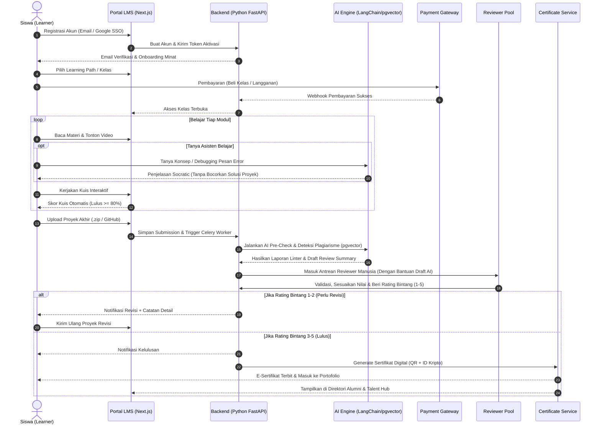
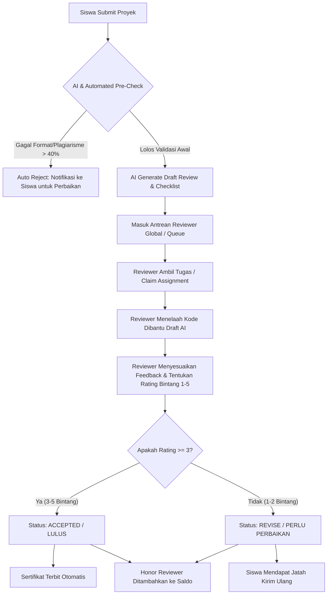
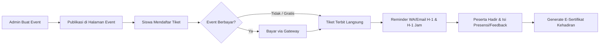

# Business Requirements Document (BRD)
## Platform Edukasi Teknologi & Talent Accelerator LMS

**Kode Dokumen:** BRD-LMS-2026-001  
**Versi:** 1.0.0  
**Tanggal Terbit:** 25 Oktober 2026  
**Penyusun:** Antigravity Solution Architecture & Product Strategy Team  
**Klasifikasi:** Internal & Stakeholder Confidential  
**Dokumen Referensi:** [brieft.md](file:///Users/kerasakti/Documents/LMS/brieft.md), [PRD.md](file:///Users/kerasakti/Documents/LMS/PRD.md)  

---

## 1. Pendahuluan (Introduction)

### 1.1 Latar Belakang Bisnis
Pertumbuhan ekonomi digital di Asia Tenggara menuntut ketersediaan jutaan tenaga ahli teknologi berkualifikasi tinggi di bidang *Software Engineering, Artificial Intelligence, Cloud Infrastructure, Data Science,* dan *Cybersecurity*. Namun, terdapat kesenjangan lebar (*skills gap*) antara materi perkuliahan akademis tradisional dengan standar kebutuhan industri teknologi saat ini.

Platform kursus online konvensional (*video-based MOOC*) terbukti memiliki tingkat penyelesaian (*completion rate*) di bawah 10% karena minimnya interaksi, tidak adanya validasi kode mandiri, dan ketiadaan bimbingan mentor. Mengadopsi kesuksesan platform seperti **Dicoding.com**, bisnis ini dibangun dengan pilar **Human-in-the-Loop Code Review**, kurikulum bertahap dari pemula (*Basic*) hingga mahir (*Advance*), ekosistem komunitas aktif, serta integrasi langsung ke perusahaan pencari kerja (*Hiring Partners*).

### 1.2 Tujuan Dokumen
Dokumen Kebutuhan Bisnis (BRD) ini bertujuan mendefinisikan:
1. Alasan fundamental investasi bisnis (*business rationale*) dan model monetisasi.
2. Ekspektasi seluruh pemangku kepentingan (*stakeholders*).
3. Batasan ruang lingkup (*scope*), proses bisnis tingkat tinggi, dan aturan bisnis (*business rules*).
4. Metrik keberhasilan bisnis (*business KPIs*) yang terukur.

---

## 2. Tujuan Bisnis & Sasaran Strategis (Business Objectives)

Setiap inisiatif dalam proyek ini harus mendukung sasaran SMART (*Specific, Measurable, Achievable, Relevant, Time-bound*) berikut:

| Sasaran Bisnis (SMART Goal) | Indikator Kunci (KPI) | Target Tahun ke-1 | Target Tahun ke-2 |
|---|---|---|---|
| **Akselerasi Pengguna Baru** | Total pengguna terdaftar (*Registered Learners*) | 50.000 siswa aktif | 200.000 siswa aktif |
| **Tingkat Kelulusan Tinggi** | *Course Completion Rate* (Dibandingkan rata-rata industri 8%) | Minimal 28% | Minimal 35% |
| **Kualitas Validasi Kode** | *Submission Turnaround Time* (Waktu respons review kode) | < 36 jam (Rata-rata 18 jam) | < 24 jam (Rata-rata 12 jam) |
| **Kepuasan Pembelajar** | *Net Promoter Score* (NPS) & Rating Reviewer | NPS > +55, Rating > 4.7/5.0 | NPS > +65, Rating > 4.8/5.0 |
| **Penyaluran Kerja Talenta** | *Job Placement Rate* (Lulusan Advance diserap kerja < 6 bln) | 45% dari total lulusan | 65% dari total lulusan |
| **Keberlanjutan Finansial** | *Monthly Recurring Revenue* (MRR) & Margin Operasional | ARR Rp 3,5 Miliar | ARR Rp 12,5 Miliar |

---

## 3. Analisis Stakeholder & RACI Matrix

### 3.1 Identifikasi Stakeholder
1. **Siswa / Pembelajar (Learners):** Pengguna akhir yang mengonsumsi materi, mengerjakan kuis, mengirimkan proyek coding, dan mencari pekerjaan.
2. **Reviewer & Tim Pengajar (Instructors & Mentors):** Tenaga ahli dari industri yang menyusun materi dan membedah kode proyek siswa secara objektif.
3. **Manajemen Akademik & Tim Kurikulum:** Bertanggung jawab atas relevansi silabus, standarisasi materi, dan audit mutu review.
4. **Hiring Partner (Perusahaan Mitra Rekruter):** Startup, BUMN, dan korporasi teknologi yang menyerap lulusan bersertifikasi.
5. **Sponsor Beasiswa / CSR / Pemerintah:** Lembaga yang mendanai program pelatihan massal (e.g. Kementerian, Kampus Merdeka, CSR Perusahaan).
6. **Tim Manajemen, Operasional & Finansial:** Mengelola bisnis, pembayaran, legalitas, dan infrastruktur sistem.

### 3.2 RACI Matrix Bisnis

| Area Kerja / Proses Bisnis | Learner | Reviewer / Mentor | Tim Kurikulum | Hiring Partner | Platform Admin | C-Level / Sponsor |
|---|:---:|:---:|:---:|:---:|:---:|:---:|
| Penyusunan & Update Silabus Kelas | I | C | **A / R** | C | I | I |
| Pendaftaran & Pembayaran Kelas | **R** | I | I | I | A | I |
| Penilaian Kuis Otomatis | **R** | I | A | I | I | I |
| Pemeriksaan Submission Kode & Rubrik | A | **R** | C | I | I | I |
| Penerbitan Sertifikat Resmi | I | I | A | I | **R** | I |
| Penyelenggaraan Seminar & Webinar | C | **R** | C | I | **A** | I |
| Penyaluran Kerja & Talent Sourcing | C | I | I | **R** | **A** | I |
| Penanganan Keluhan & Mediasi Nilai | C | C | **A** | I | **R** | I |

*Keterangan: R = Responsible (Pelaksana), A = Accountable (Penanggung Jawab Akhir), C = Consulted (Konsultan), I = Informed (Penerima Informasi).*

---

## 4. Model Bisnis & Arsitektur Monetisasi (Revenue Streams)

Platform mengombinasikan beberapa jalur pendapatan (*hybrid revenue model*) yang saling melengkapi:

### 4.1 B2C - Single Purchase & Subscription Pass
1. **Pembelian Kelas Tunggal (*Pay-per-course*):**
   - Siswa membeli 1 kelas spesifik dengan akses materi dan jatah submission selamanya (misal: "Belajar Dasar Pemrograman Web" Rp 150.000, "Menjadi React Developer Expert" Rp 750.000).
2. **Model Berlangganan (*Subscription Pass*):**
   - Akses tak terbatas ke seluruh *Learning Path* selama langganan aktif:
     - Bulanan: Rp 299.000 / bulan.
     - 6 Bulan: Rp 1.499.000.
     - 1 Tahun: Rp 2.499.000 (diskon 30%).

### 4.2 B2B - Corporate Upskilling & CSR Scholarship
1. **Corporate Batch Training:** Pelatihan internal tim IT perusahaan dengan kurikulum yang disesuaikan dan dashboard pemantauan progres tim (*Enterprise Analytics*).
2. **Bulk Token Activation:** Penjualan kuota token beasiswa kepada institusi sponsor (e.g. CSR bank, BUMN, instansi pendidikan) untuk ribuan siswa dengan laporan dampak program (*impact report*).

### 4.3 Talent Placement & Recruitment Hub
1. **Akses Direktori Bakat (*Talent Sourcing Fee*):** HRD membayar biaya langganan bulanan untuk memfilter, melihat kode proyek asli, dan menghubungi kandidat alumni terbaik.
2. **Recruitment Success Fee:** Komisi 10%–15% dari gaji tahunan pertama ketika kandidat berhasil dipekerjakan melalui platform.

### 4.4 Event, Seminar & Sponsorship
1. **Tiket Workshop Hands-on:** Event interaktif eksklusif bersama pembicara ternama (harga tiket Rp 50.000 – Rp 250.000).
2. **Sponsorship Platform:** Pendapatan iklan/sponsor dari penyedia cloud (AWS, GCP, Alibaba Cloud) atau vendor dev-tools pada event seminar dan artikel berita.

---

## 5. Cakupan Bisnis (Business Scope)

### 5.1 In-Scope (Termasuk dalam Cakupan Proyek)
- **Arsitektur Inti:** Backend berbasis Python (FastAPI), Frontend Next.js (App Router), dan basis data PostgreSQL 16+ dengan `pgvector`.
- **Ekosistem Pembelajaran Terstruktur:**
  - Sistem Registrasi, Login, SSO (Google & GitHub), Verifikasi Email, dan Manajemen Profil.
  - Jalur Belajar Berjenjang (*Learning Path*) dengan kelas berstatus Pemula, Menengah, hingga Mahir.
  - **In-Browser Cloud IDE & WebContainers (Zero-Setup Coding):** Eksekusi kode langsung di browser tanpa instalasi compiler lokal.
  - Sistem Kuis Pilihan Ganda berbatas waktu dengan penilaian otomatis dan mekanisme jeda *cooldown*.
  - **Dual-Engine Submission Review:** Validasi otomatis dalam 10 detik oleh AI Pre-Reviewer + audit mendalam oleh reviewer manusia (skala bintang 1–5, SLA < 12 jam).
- **Ekosistem Interaksi & Komunitas:**
  - **Developer Coaching:** Sesi mentoring tatap muka daring mingguan bagi siswa langganan.
  - **Virtual Study Room 24/7 & Live Pair-Programming:** Ruang belajar virtual bersama pembelajar lain dengan Pomodoro timer & multi-cursor live coding.
  - Ruang Diskusi Q&A Kontekstual per modul materi dengan sistem *Upvote*, *Best Answer*, dan pencarian semantik AI.
  - **Reviewer Guild (Dicoding Elite Equivalent):** Wadah instruktur dan reviewer dengan dashboard antrean FIFO dan saldo honorarium otomatis.
- **Kompetisi, Gamifikasi & Apresiasi:**
  - **Coding Challenge:** Kompetisi bertarget disponsori oleh korporasi dengan hadiah uang tunai, merchandise, dan token.
  - **Live Coding Arena:** Duel adu cepat algoritma mingguan dengan leaderboard kompetitif.
  - **RPG Visual Skill Tree & Reward Store:** Poin belajar (XP) dapat ditukarkan di katalog merchandise resmi, gadget, dan voucher belajar.
- **Sertifikasi, Portofolio & Penyaluran Kerja:**
  - Kredensial digital berstandar kriptografi SHA-256, Halaman Verifikasi Publik, dan 1-klik Add to LinkedIn.
  - **Code Keystroke Replay Player:** Rekaman proses coding siswa dari nol yang dapat diputar ulang oleh rekruter untuk membuktikan orisinalitas karya (anti-joki).
  - **AI Mock Technical Interview Simulator:** Ujian simulasi wawancara kerja teknologi dengan AI sebelum siswa lulus kelas Advance.
  - Direktori Alumni & Talent Hub dengan fitur **Reverse Hiring** (perusahaan mengajukan tawaran wawancara ke lulusan).
- **Kemitraan, Event & Beasiswa Massal:**
  - Modul Event & Seminar (Pendaftaran, kuota, presensi, e-sertifikat kehadiran).
  - **Multi-Phase Cohort Scholarship Engine:** Pengelolaan kuota token beasiswa massal (IDCamp/Bangkit style) dengan laporan analitik dampak sponsor.
  - Portal Berita, Artikel Teknis, dan Blog Informasi Industri.
  - Integrasi Payment Gateway lokal (VA, QRIS, E-Wallet, Kartu Kredit).
  - Dashboard Admin & B2B Enterprise Dashboard untuk pelaporan performa belajar karyawan.

### 5.2 Out-of-Scope (Tidak Termasuk dalam Fase Awal)
- Pembuatan aplikasi native iOS dan Android (Fase awal menggunakan Responsive Web & Progressive Web App).
- Sistem Live Video Streaming server mandiri (Menggunakan integrasi tautan pihak ketiga seperti Zoom, Google Meet, atau YouTube Live).
- Penggajian / Payroll Reviewer otomatis ke rekening bank (Fase awal menggunakan laporan kalkulasi CSV yang dieksekusi secara manual oleh tim keuangan).

---

## 6. Alur Proses Bisnis End-to-End (Process Flows)

### 6.1 Alur Registrasi, Pembelajaran, dan Sertifikasi Siswa

### 6.2 Alur Antrean & Pemeriksaan Submission Berbantu AI

### 6.3 Alur Seminar & Pendaftaran Event

---

## 7. Aturan Bisnis Utama (Business Rules)

| ID Aturan | Domain | Ketentuan Aturan Bisnis |
|---|---|---|
| **BR-REG-01** | Pendaftaran | Siswa wajib memiliki alamat email yang unik dan terverifikasi sebelum dapat melakukan transaksi atau mengirimkan submission. |
| **BR-PRQ-02** | Learning Path | Siswa tidak dapat mendaftar atau mengakses kelas tingkat *Menengah* sebelum lulus seluruh kelas prasyarat tingkat *Pemula* dalam learning path yang sama, kecuali mengambil opsi *Placement Test* lulus dengan skor > 85%. |
| **BR-QZ-03** | Kuis | Batas kelulusan kuis adalah 80%. Siswa yang gagal diberi masa jeda (*cooldown*) 1 jam pada percobaan ke-1 dan ke-2, serta 24 jam pada kegagalan ke-3 dan seterusnya untuk mencegah tebakan acak. |
| **BR-SUB-04** | Submission | Siswa memiliki maksimal 3 kesempatan revisi per submission. Jika ketiga revisi tetap berstatus bintang 1–2, siswa diwajibkan menjadwalkan sesi konsultasi daring atau mengulang materi modul terkait. |
| **BR-SLA-05** | Reviewer SLA | Batas waktu maksimal (*Service Level Agreement*) pemeriksaan submission oleh reviewer adalah 24 jam kerja untuk kelas Pemula dan 48 jam kerja untuk kelas Menengah/Advance (dipercepat oleh bantuan AI Draft Review). Keterlambatan review akan dikenakan penalti potongan honor reviewer. |
| **BR-PLG-06** | Anti-Plagiarisme | Submission yang terdeteksi menjiplak karya siswa lain atau sumber internet lebih dari 40% kesamaan kode (melalui analisis AST & semantic embedding pgvector) akan langsung digugurkan (*auto-reject* Bintang 1) dan siswa diberikan surat peringatan integritas akademik. |
| **BR-CRT-07** | Sertifikasi | Sertifikat Kompetensi berlaku selama 3 tahun sejak tanggal penerbitan. Halaman verifikasi publik tetap aktif permanen untuk membuktikan riwayat kelulusan. |
| **BR-REF-08** | Kebijakan Refund | Pengembalian dana (*refund*) kelas satuan hanya berlaku dalam 7 hari kalender sejak pembelian, dengan syarat progres belajar siswa masih di bawah 15% dan belum pernah mengikuti kuis atau mengirim submission. |
| **BR-AI-09** | AI Guardrails | Asisten AI Coding Tutor dilarang secara sistematis memberikan kode solusi lengkap untuk tugas akhir/submission (hanya diizinkan memandu alur logika dan memberikan petunjuk konsep / *Socratic guidance*). |
| **BR-AI-10** | Privasi Model AI | Seluruh berkas submission dan data pribadi siswa tidak boleh digunakan sebagai data pelatihan (*training data*) model publik pihak ketiga tanpa izin tertulis (*Zero-Data Retention Policy*). |

---

## 8. Kebutuhan Non-Fungsional Bisnis (Non-Functional Requirements)

1. **Ketersediaan Sistem (Availability & Reliability):**
   - Tingkat ketersediaan platform minimal **99.9% uptime** per bulan (downtime terencana maksimal 45 menit per bulan di luar jam sibuk 01:00 - 05:00 WIB).
2. **Kapasitas & Skalabilitas (Scalability):**
   - Mampu menangani hingga **25.000 pengguna aktif bersamaan** (*concurrent users*) saat seminar atau pengumuman beasiswa tanpa degradasi performa.
3. **Kepatuhan Hukum & Privasi Data (Data Privacy & Compliance):**
   - Kepatuhan penuh terhadap **Undang-Undang No. 27 Tahun 2022 tentang Pelindungan Data Pribadi (UU PDP)**. Data sensitif siswa (KTP, nomor telepon, alamat rumah) wajib dienkripsi saat transit (TLS 1.3) dan saat diam (AES-256).
   - Hak pengguna untuk penghapusan data (*Right to be Forgotten*) harus difasilitasi dalam waktu maksimal 14 hari kerja.
4. **Keamanan Transaksi Finansial:**
   - Standar keamanan PCI-DSS Tier 1 difasilitasi oleh penyedia Payment Gateway berlisensi resmi Bank Indonesia.
5. **Integritas Sertifikat:**
   - Setiap sertifikat dilindungi tanda tangan digital kriptografi (*SHA-256 hash*) untuk menjamin keaslian dokumen dari manipulasi visual.

---

## 9. Analisis Risiko Bisnis & Rencana Mitigasi

| Risiko Bisnis | Probabilitas | Dampak | Rencana Mitigasi Strategis |
|---|:---:|:---:|---|
| **Penumpukan Antrean Submission (Reviewer Bottleneck)** saat musim beasiswa atau akhir semester. | Tinggi | Tinggi | - Rekrutmen *freelance reviewer* fleksibel dengan insentif dinamis (*surge pricing honor* saat antrean > 100 tugas). - Terapkan *automated linting pre-check* untuk menggugurkan kode yang gagal dijalankan sebelum masuk antrean manusia. |
| **Plagiarisme & Joki Tugas Submission.** | Sedang | Sangat Tinggi | - Integrasi algoritma *AST-based Code Plagiarism Detector* (seperti MOSS atau JPlag). - Terapkan wawancara acak (*random video defense*) bagi peraih nilai bintang 5 sebelum sertifikat diterbitkan. |
| **Ketidaksesuaian Kurikulum dengan Kebutuhan Industri.** | Sedang | Tinggi | - Membentuk *Curriculum Advisory Board* bersama CTO dan Tech Lead dari 10+ perusahaan teknologi ternama yang mengaudit silabus setiap 6 bulan sekali. |
| **Tingginya Churn Rate pada Pelanggan Subscription.** | Tinggi | Sedang | - Notifikasi pengingat belajar berkala via WhatsApp. - Gamifikasi tantangan harian (*Daily Streak*) berhadiah voucher atau merchandise. - Event mentoring komunitas mingguan eksklusif member. |

---

## 10. Persetujuan & Tanda Tangan (Sign-off Matrix)

| Nama Pemangku Kepentingan | Jabatan | Tanggal Persetujuan | Tanda Tangan / Status |
|---|---|---|---|
| **Direktur Eksekutif / Founder** | Executive Sponsor | 25 Oktober 2026 | [ APPROVED ] |
| **VP of Product & Engineering** | Head of Product | 25 Oktober 2026 | [ APPROVED ] |
| **Head of Curriculum & Academics** | Lead Educator | 25 Oktober 2026 | [ APPROVED ] |
| **Head of Business Development** | Partnership & Growth | 25 Oktober 2026 | [ APPROVED ] |
