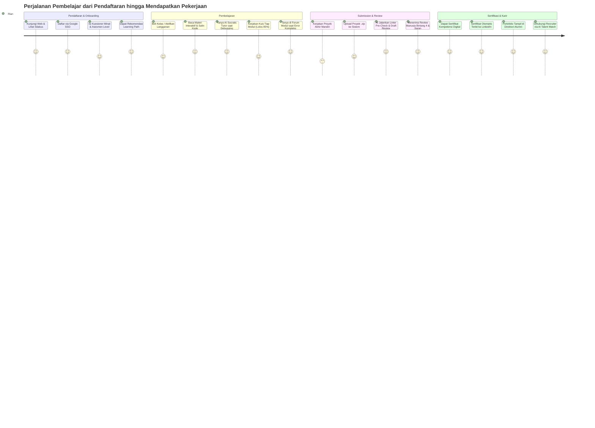
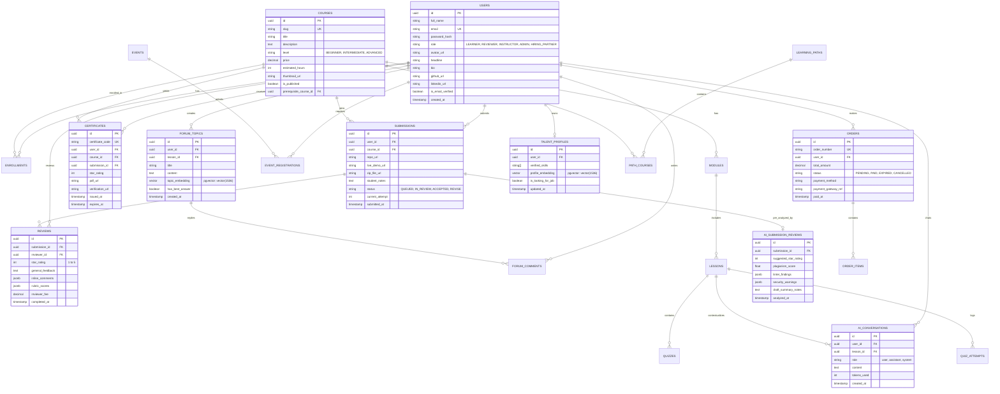

# Product Requirements Document (PRD)
## Platform Edukasi Teknologi & Akselerator Talenta Digital

**Kode Dokumen:** PRD-LMS-2026-001  
**Versi:** 1.0.0  
**Tanggal Terbit:** 25 Oktober 2026  
**Penulis Utama:** Antigravity Product & Engineering Architecture Team  
**Status Dokumen:** READY FOR SPRINT PLANNING  
**Dokumen Referensi:** [brieft.md](file:///Users/kerasakti/Documents/LMS/brieft.md), [BRD.md](file:///Users/kerasakti/Documents/LMS/BRD.md)  

---

## 1. Pendahuluan Produk (Product Overview)

### 1.1 Visi & Arsitektur Teknologi Inti
Menciptakan platform *learning experience* interaktif berstandar industri teknologi terdepan di Indonesia, yang memandu pembelajar dari nol hingga siap kerja melalui jalur belajar kuratif (*Learning Path*), validasi kode baris-per-baris oleh praktisi (*Human Code Review*), asisten kecerdasan buatan (*AI Learning Copilot*), kredensial resmi terverifikasi, dan koneksi langsung ke ekosistem industri (*Hiring Partners*).

**Standardisasi Teknologi:**
- **Frontend:** Next.js 15+ (App Router, React 19, TypeScript, Monaco Editor, Tailwind CSS / Vanilla Design System).
- **Backend:** Python 3.12+ (FastAPI Async, Pydantic v2, SQLAlchemy 2.0 ORM, Celery Background Workers).
- **Database:** PostgreSQL 16+ dengan ekstensi **`pgvector`** (ACID Transactional + Vector Similarity Search).
- **AI Engine:** Python LangChain / LlamaIndex / Gemini 1.5 / OpenAI Embeddings dengan Zero-Data-Retention guardrails.

### 1.2 Prinsip Desain Produk (Core Product Principles)
1. **Action-First Learning:** Minimalkan membaca teori pasif, maksimalkan penulisan kode nyata (*hands-on coding*).
2. **Zero-Ambiguity Feedback:** Setiap evaluasi proyek harus memberikan arahan revisi yang presisi hingga level baris kode.
3. **AI as an Accelerator, Not a Shortcut:** AI bertindak sebagai pemandu sokratik (*Socratic tutor*) dan asisten reviewer, bukan pembuat solusi jalan pintas.
4. **Credibility over Easy Wins:** Sertifikat kelulusan harus memiliki prestise tinggi di mata HRD karena disaring melalui kriteria kelulusan ketat.
5. **Community Support at Arm's Length:** Siswa tidak boleh merasa belajar sendirian; bantuan instruktur dan sesama pembelajar selalu tersedia di setiap modul.

---

## 2. User Personas & User Journey Maps

### 2.1 Ringkasan Personas

| Persona | Profil & Latar Belakang | Motivasi Utama | Titik Masalah (*Pain Points*) |
|---|---|---|---|
| **Rian (22 thn) — Aspiring Developer** | Mahasiswa Teknik Informatika semester akhir. | Ingin menjadi Backend Engineer di startup unicorn dan memiliki portofolio valid. | Bingung urutan belajar, sering frustrasi saat menghadapi error tanpa ada yang membimbing. |
| **Siti (28 thn) — Career Switcher** | Staf administrasi yang ingin beralih profesi ke UI/UX Designer atau Web Developer. | Membutuhkan sertifikat resmi yang diakui industri dan mentoring yang ramah pemula. | Waktu belajar terbatas (hanya malam dan akhir pekan), takut materi terlalu matematis/rumit. |
| **Budi (31 thn) — Senior Reviewer** | Senior Software Engineer di perusahaan e-commerce global. | Berbagi ilmu, membangun reputasi profesional, dan mendapatkan penghasilan tambahan fleksibel. | Sistem review yang lambat, submission siswa berantakan tanpa linter dasar, waktu review habis untuk hal sepele. |
| **Jessica (34 thn) — Tech Recruiter** | Talent Acquisition Lead di perusahaan teknologi fintech. | Merekrut Junior-Mid Developer yang terbukti bisa menulis *clean code* dan problem solving. | Banjir lamaran dengan CV bagus tapi saat *technical test* banyak yang gagal atau plagiat. |

### 2.2 Peta Perjalanan Siswa (Student User Journey)



---

## 3. Rincian Epics & User Stories (Functional Specifications)

Berikut adalah 20 Epics terintegrasi yang mencakup 100% kesetaraan fitur Dicoding.com serta 8 Pilar Inovasi Keunggulan (*Unfair Advantages*):

```
┌─────────────────────────────────────────────────────────────────────────────┐
│                       STRUKTUR 20 EPICS FITUR LMS                           │
├─────────────────────┬─────────────────────┬─────────────────────────────────┤
│ EPIC-01: Autentikasi│ EPIC-02: Learning   │ EPIC-03: Interactive Classroom  │
│          & Profil   │          Path       │          & Media Player         │
├─────────────────────┼─────────────────────┼─────────────────────────────────┤
│ EPIC-04: Kuis       │ EPIC-05: Submission │ EPIC-06: Sertifikat Digital &   │
│          Otomatis   │          Review     │          Halaman Verifikasi     │
├─────────────────────┼─────────────────────┼─────────────────────────────────┤
│ EPIC-07: Seminar &  │ EPIC-08: Portal     │ EPIC-09: Portfolio Showcase     │
│          Webinar    │          Berita     │          Siswa                  │
├─────────────────────┼─────────────────────┼─────────────────────────────────┤
│ EPIC-10: Alumni &   │ EPIC-11: Forum Q&A  │ EPIC-12: Portal Instruktur &    │
│          Talent Hub │          Komunitas  │          Antrean Reviewer       │
├─────────────────────┼─────────────────────┼─────────────────────────────────┤
│ EPIC-13: Transaksi &│ EPIC-14: Admin      │ EPIC-15: AI Learning Copilot &  │
│          Billing    │          Backoffice │          Reviewer Assistant     │
├─────────────────────┼─────────────────────┼─────────────────────────────────┤
│ EPIC-16: Coding     │ EPIC-17: Gamifikasi │ EPIC-18: Virtual Study Room     │
│          Challenge  │          & Rewards  │          & Pair Programming     │
├─────────────────────┼─────────────────────┼─────────────────────────────────┤
│ EPIC-19: In-Browser │ EPIC-20: AI Mock    │                                 │
│          Cloud IDE  │          Interview  │                                 │
└─────────────────────┴─────────────────────┴─────────────────────────────────┘
```

---

### EPIC-01: Autentikasi, Profil & Onboarding Cerdas

#### US-01.1: Registrasi Akun Mandiri & SSO
*Sebagai calon siswa, saya ingin mendaftar menggunakan email atau akun Google/GitHub, agar proses pendaftaran cepat dan aman.*
- **Kriteria Keberterimaan (Acceptance Criteria):**
  - **Scenario 1:** Pendaftaran dengan Email & Password
    - `GIVEN` Calon pengguna berada di halaman `/register`
    - `WHEN` Mengisi nama lengkap, alamat email valid, password (minimal 8 karakter, kombinasi huruf besar, kecil, angka, simbol)
    - `THEN` Sistem mengirimkan email verifikasi berisi token aktivasi 6 digit / magic link yang berlaku selama 15 menit
    - `AND` Akun berstatus `UNVERIFIED` sampai email berhasil dikonfirmasi.
  - **Scenario 2:** Pendaftaran via Social SSO (Google & GitHub)
    - `GIVEN` Calon pengguna memilih tombol "Lanjutkan dengan Google" atau "GitHub"
    - `WHEN` Berhasil mengotorisasi akun di penyedia identitas OAuth2
    - `THEN` Sistem otomatis membuat akun baru dengan status `VERIFIED` dan mengarahkan ke langkah *Onboarding*.

#### US-01.2: Onboarding Survey & Rekomendasi Alur Belajar
*Sebagai pengguna baru, saya ingin mengisi kuesioner minat dan asesmen latar belakang, agar sistem dapat merekomendasikan jalur belajar yang paling sesuai.*
- **Kriteria Keberterimaan:**
  - Menampilkan 3 pertanyaan interaktif:
    1. Fokus bidang minat: *Frontend, Backend, Mobile (Flutter/Android), Data/AI, UI/UX*.
    2. Tingkat pemahaman saat ini: *Pemula Mutlak (Belum pernah coding), Menengah (Paham konsep dasar), Mahir (Sudah bekerja di IT)*.
    3. Target waktu komitmen per minggu: *< 5 jam, 5-15 jam, > 15 jam*.
  - Menampilkan kartu rekomendasi *Learning Path* yang cocok dengan tombol "Mulai Belajar Sekarang".

---

### EPIC-02: Katalog Kelas & Hierarki Learning Path

#### US-02.1: Navigasi Learning Path Berjenjang
*Sebagai siswa, saya ingin melihat peta jalan belajar (Learning Path) terstruktur, agar saya mengetahui tahapan kelas yang harus saya lalui dari tingkat dasar hingga mahir.*
- **Kriteria Keberterimaan:**
  - Menampilkan visualisasi garis alur vertikal/horizontal yang menghubungkan urutan kelas.
  - Setiap kelas pada alur memiliki penanda level yang jelas:
    - `DASAR / PEMULA` (Badge Hijau)
    - `MENENGAH / INTERMEDIATE` (Badge Biru)
    - `MAHIR / ADVANCE` (Badge Ungu)
  - Kelas lanjutan memiliki ikon gembok (*locked*) jika kelas prasyarat (*prerequisite*) belum diselesaikan dengan kelulusan bintang minimal 3.
  - Tersedia informasi estimasi total durasi jam belajar, silabus modul, dan profil instruktur pengampu.

---

### EPIC-03: Interactive Classroom & Media Player

#### US-03.1: Pembelajaran Konten Teks & Cuplikan Kode Interaktif
*Sebagai siswa, saya ingin membaca materi dengan format teks kaya, sintaks kode berwarna, dan tombol salin instan, agar saya dapat mempraktikkan kode dengan nyaman.*
- **Kriteria Keberterimaan:**
  - Syntax highlighting mendukung 20+ bahasa pemrograman (JavaScript, TypeScript, Python, Dart, Kotlin, Go, PHP, HTML/CSS).
  - Tombol 1-klik "Salin Kode" dengan feedback visual "Tersalin!".
  - Mendukung penyisipan diagram interaktif (Mermaid.js) dan blok peringatan penting (Note, Warning, Tip).
  - Indikator kemajuan membaca (*scroll reading indicator*) yang otomatis mencentang status "Selesai Dibaca" ketika siswa mencapai 90% panjang halaman materi.

#### US-03.2: Pemutar Video Terintegrasi (Video Player)
*Sebagai siswa, saya ingin menonton video penjelasan dengan kontrol pemutaran lengkap, agar saya dapat menyesuaikan kecepatan belajar saya.*
- **Kriteria Keberterimaan:**
  - Kontrol kecepatan pemutaran: 0.5x, 0.75x, 1x, 1.25x, 1.5x, 2x.
  - Mendukung multi-resolusi otomatis dan manual (360p, 480p, 720p, 1080p).
  - Fitur *Auto Resume*: Pemutar video secara otomatis melanjutkan dari detik terakhir yang ditonton ketika halaman dimuat ulang.
  - Mencegah *skipping* curang: Tombol "Tandai Selesai" baru aktif jika video telah ditonton minimal 85% durasi.

---

### EPIC-04: Kuis Otomatis Berjenjang (Automated Quiz Engine)

#### US-04.1: Pengerjaan Kuis Pilihan Ganda Berbatas Waktu
*Sebagai siswa, saya ingin menguji pemahaman modul melalui kuis interaktif, agar saya mengetahui apakah saya sudah menguasai materi sebelum lanjut.*
- **Kriteria Keberterimaan:**
  - Bank soal acak: Sistem mengacak urutan pertanyaan dan opsi jawaban (A, B, C, D, E) untuk tiap percobaan.
  - Tampilan *Countdown Timer* mengambang (*floating timer*) di bagian atas layar.
  - Fitur navigasi soal: Tombol "Ragu-ragu", daftar nomor soal dengan indikator warna (Hijau: Terjawab, Kuning: Ragu, Abu-abu: Belum Terjawab).
  - Dialog konfirmasi saat klik "Kirim Jawaban" yang memperingatkan jika ada soal yang belum diisi.

#### US-04.2: Evaluasi Skor & Mekanisme Cooldown
*Sebagai siswa, saya ingin melihat skor kuis seketika setelah selesai beserta penjelasan pembahasannya.*
- **Kriteria Keberterimaan:**
  - Ambang batas lulus (*Passing Grade*): Minimal 80%.
  - Jika `Skor >= 80%`:
    - Status: **LULUS (Passed)**.
    - Modul berikutnya terbuka secara instan.
    - Menampilkan ringkasan nomor soal yang benar dan salah beserta penjelasan komprehensif.
  - Jika `Skor < 80%`:
    - Status: **BELUM LULUS (Failed)**.
    - Mengaktifkan waktu tunggu (*cooldown penalty*):
      - Percobaan ke-1 gagal: Waktu tunggu 30 menit.
      - Percobaan ke-2 gagal: Waktu tunggu 2 jam.
      - Percobaan ke-3 gagal: Waktu tunggu 24 jam.
    - Kunci tombol "Ulangi Kuis" hingga masa cooldown selesai.

---

### EPIC-05: Submission Proyek & Human Code Reviewer Engine (Core USP)

#### US-05.1: Pengunggahan Tugas Proyek Mandiri
*Sebagai siswa kelas Menengah dan Advance, saya ingin mengunggah proyek akhir yang saya bangun, agar dapat dinilai oleh tim reviewer ahli.*
- **Kriteria Keberterimaan:**
  - Formulir submission menerima input:
    1. Berkas arsip kode `.zip` (Maksimal 50 MB, mengecualikan `node_modules`, `.git`, `.venv`).
    2. URL Repositori Git (GitHub / GitLab / Bitbucket) publik atau tautan token akses.
    3. URL Live Deployment / Demo Aplikasi (Vercel, Netlify, Cloud Run, APK link).
    4. Catatan untuk reviewer (opsional: petunjuk akun uji coba, kredensial demo).
  - Pengecekan otomatis awal (*Automated Pre-Check*):
    - Validasi struktur file wajib (misal: keberadaan file `index.html` atau `package.json` atau `main.dart`).
    - Jika gagal validasi awal, sistem langsung menolak berkas dengan pesan kesalahan spesifik tanpa membuang kuota review.

#### US-05.2: Antarmuka Pemeriksaan & Pemberian Feedback oleh Reviewer
*Sebagai reviewer, saya ingin memeriksa berkas proyek, menguji aplikasi, membubuhkan komentar baris kode, dan memberikan rating bintang, agar siswa mendapatkan bimbingan perbaikan nyata.*
- **Kriteria Keberterimaan:**
  - *Code Viewer Web:* Reviewer dapat menjelajahi pohon file (*file tree*) dan membaca isi kode dengan syntax highlighter langsung di browser.
  - *Inline Commenting:* Reviewer dapat mengeklik nomor baris kode tertentu untuk menyematkan komentar revisi teknis.
  - *Scoring Rubrics:*
    - Skala nilai: Bintang 1 hingga Bintang 5.
    - Checklist kriteria wajib (*Mandatory Requirements*): Wajib tercentang 100% untuk mendapatkan minimal Bintang 3.
    - Checklist kriteria bonus (*Optional / Bonus Requirements*): Membuka peluang nilai Bintang 4 atau 5.
  - Pilihan Hasil Keputusan:
    - **Tolak / Perlu Revisi (Bintang 1–2):** Siswa wajib memperbaiki proyek dan mengirimkan kembali.
    - **Lulus (Bintang 3–5):** Siswa dinyatakan lulus kelas dan berhak atas sertifikat.
  - Mengharuskan reviewer menulis minimal 200 karakter feedback komprehensif (mencegah review asal-asalan).

---

### EPIC-06: Sertifikasi Digital & Kredensial Resmi

#### US-06.1: Penerbitan Sertifikat & Halaman Verifikasi Publik
*Sebagai siswa yang telah lulus kelas, saya ingin menerima sertifikat digital resmi yang dapat diverifikasi oleh rekruter, agar membuktikan kredibilitas kompetensi saya.*
- **Kriteria Keberterimaan:**
  - Sistem menghasilkan ID Sertifikat unik berformat: `CERT-{TRACK}-{TAHUN}-{NANOID}` (e.g. `CERT-FE-2026-9A82XF`).
  - Halaman Verifikasi Publik beralamat permanen: `https://lms.domain.com/certificates/{cert_id}` yang dapat diakses publik tanpa login.
  - Halaman verifikasi menampilkan:
    - Nama Lengkap Siswa.
    - Judul Kelas & Learning Path.
    - Tanggal Terbit & Tanggal Kedaluwarsa (3 tahun).
    - Daftar Kompetensi Teknis yang Dikuasai (*Key Competencies*).
    - Tautan Portofolio Proyek Tugas Akhir yang diselesaikan.
    - Rating Bintang yang diraih (Bintang 3, 4, atau 5).
  - Tombol "Unduh Sertifikat PDF" (Resolusi cetak 300 DPI dengan latar belakang watermark dan QR Code dinamis).
  - Tombol "Add to LinkedIn" yang secara otomatis mengisi *Certification Name, Issuing Organization, Issue Date, Expiration Date,* dan *Credential URL*.

---

### EPIC-07: Seminar, Workshop & Event Management

#### US-07.1: Eksplorasi & Pendaftaran Event
*Sebagai pengguna, saya ingin menelusuri agenda seminar dan mendaftar secara online, agar saya dapat memperluas wawasan dan jaringan profesional.*
- **Kriteria Keberterimaan:**
  - Halaman katalog event dengan filter: *Semua, Akan Datang, Selesai, Gratis, Berbayar*.
  - Informasi detail: Judul, Profil Pembicara (Foto, Jabatan, Perusahaan), Jadwal (Hari, Tanggal, Jam WIB), Sisa Kuota Peserta, Fasilitas (Materi, Rekaman, E-Sertifikat).
  - Status pendaftaran:
    - Jika kuota masih ada: Tombol "Daftar Sekarang".
    - Jika kuota penuh: Tombol "Daftar Waiting List".
  - Notifikasi otomatis konfirmasi tiket via Email dan WhatsApp yang menyertakan format kalender `.ics` (*Add to Google Calendar*).

#### US-07.2: Presensi Kehadiran & E-Sertifikat Event
*Sebagai peserta seminar, saya ingin melakukan absensi kehadiran dan mengunduh sertifikat seminar, agar saya memiliki bukti keikutsertaan.*
- **Kriteria Keberterimaan:**
  - Form presensi aktif hanya selama 60 menit saat acara berlangsung (dilindungi kode token unik yang dibagikan oleh moderator).
  - Peserta wajib mengisi survei umpan balik (*Event Feedback Form*) 3-5 pertanyaan.
  - Setelah feedback terkirim, E-Sertifikat Kehadiran otomatis digenerate dan dikirimkan ke email peserta dalam format PDF.

---

### EPIC-08: Portal Berita, Artikel Teknis & Editorial

#### US-08.1: Publikasi & Pembacaan Artikel Edukasi
*Sebagai pembaca/siswa, saya ingin membaca artikel teknologi terbaru, tutorial koding, dan tips karir, agar wawasan industri saya terus terbarui.*
- **Kriteria Keberterimaan:**
  - Kategori artikel: *Tutorial, Berita IT, Career Guide, Student Story / Alumni Spotlight, Product Update*.
  - Fitur pembaca: Estimasi waktu baca (*e.g. 5 min read*), daftar isi dinamis (*Table of Contents* otomatis dari tag H2/H3), bookmark simpan artikel.
  - Fitur interaksi: Tombol "Tepuk Tangan / Clap" (maksimal 50 claps per user) dan form komentar interaktif.
  - Optimasi SEO otomatis: OpenGraph metadata, JSON-LD Schema untuk Google Article, sitemap otomatis terupdate.

---

### EPIC-09: Portfolio Showcase Siswa

#### US-09.1: Galeri Portofolio Publik
*Sebagai siswa, saya ingin memamerkan proyek terbaik hasil submission saya di profil publik saya, agar dapat dilihat oleh perekrut dan publik.*
- **Kriteria Keberterimaan:**
  - Setiap submission yang lulus dengan rating Bintang 4 atau Bintang 5 memiliki toggle opsi "Tampilkan di Portofolio Publik".
  - Kartu portofolio menampilkan:
    - Tangkapan layar cover proyek (*thumbnail image*).
    - Judul Proyek & Deskripsi Singkat Masalah & Solusi.
    - Tags Teknologi (*Tech Stack Badges*: e.g. React, Node.js, PostgreSQL).
    - Tombol Live Demo & Repositori GitHub.
    - Lencana verifikasi *"Verified by Reviewer"*.
  - URL Profil Publik ramah URL: `https://lms.domain.com/u/{username}`.

---

### EPIC-10: Alumni Network & Hiring Partner Talent Hub

#### US-10.1: Direktori Pencarian Talenta oleh Hiring Partner
*Sebagai recruiter perusahaan mitra, saya ingin mencari dan menyaring lulusan berprestasi berdasarkan skill dan lokasi, agar proses rekrutmen perusahaan saya lebih efisien.*
- **Kriteria Keberterimaan:**
  - Akses terbatas hanya untuk akun dengan peran `HIRING_PARTNER`.
  - Filter pencarian komprehensif:
    - Learning Path / Spesialisasi (e.g. Frontend Web, Android, AI Engineer).
    - Skor rata-rata submission (e.g. Minimal 4 Bintang).
    - Status ketersediaan: *Siap Kerja Segera, Terbuka untuk Tawaran, Magang*.
    - Domisili kota & kesiapan remote work.
  - Tombol "Kirim Undangan Wawancara / Request Interview" yang mengirimkan proposal posisi kerja resmi ke email siswa dan dicatat dalam dashboard pelacakan kandidat.

---

### EPIC-11: Ruang Diskusi Q&A Komunitas Kontekstual

#### US-11.1: Tanya Jawab Tersemat di Setiap Modul
*Sebagai siswa yang mengalami kendala teknis/error, saya ingin bertanya langsung pada modul pelajaran terkait, agar saya mendapatkan jawaban spesifik tanpa keluar dari alur belajar.*
- **Kriteria Keberterimaan:**
  - Tab "Diskusi" tersemat di bilah kanan (*right sidebar*) setiap materi pembelajaran.
  - Editor pertanyaan mendukung format Markdown, blok kode dengan penyorotan sintaks, dan unggah gambar tangkapan layar error (maksimal 5 MB).
  - Sistem pencarian duplikasi: Saat mengetik judul pertanyaan, sistem menampilkan 3 saran pertanyaan serupa yang telah memiliki solusi (*Best Answer*).
  - Fitur voting: *Upvote* untuk pertanyaan atau jawaban yang solutif.
  - Penanda Jawaban Terbaik (*Mark as Best Answer*): Hanya dapat ditandai oleh penanya asli atau tim instruktur. Jawaban terbaik otomatis disematkan di paling atas thread.

---

### EPIC-12: Portal Instruktur, Antrean Reviewer & Honorarium

#### US-12.1: Dasbor Antrean Review (Reviewer Queue)
*Sebagai reviewer, saya ingin melihat daftar antrean proyek siswa yang menunggu untuk diperiksa, agar saya dapat mengambil tugas sesuai waktu luang saya.*
- **Kriteria Keberterimaan:**
  - Antrean bersifat FIFO (*First In First Out*) dengan pengelompokan berdasarkan keahlian (*skill tags* reviewer).
  - Tampilan indikator sisa waktu SLA (misal: "Sisa waktu review: 14 jam").
  - Tombol "Klaim Tugas (Claim Submission)": Mengunci tugas selama 3 jam untuk reviewer tersebut agar tidak dikerjakan ganda oleh reviewer lain.
  - Sistem re-queue otomatis jika reviewer tidak mengirimkan review dalam waktu 3 jam setelah klaim.

#### US-12.2: Pelacakan Saldo & Insentif Reviewer
*Sebagai reviewer, saya ingin memantau akumulasi honor hasil review proyek, agar saya mengetahui pendapatan saya secara transparan.*
- **Kriteria Keberterimaan:**
  - Besaran tarif honor per review berdasarkan tingkat kesulitan kelas:
    - Kelas Pemula: Rp 15.000 / review.
    - Kelas Menengah: Rp 35.000 / review.
    - Kelas Advance / Mahir: Rp 75.000 – Rp 120.000 / review.
  - Riwayat detail review: Tanggal, ID Submission, Nama Siswa, Nilai Diberikan, Besaran Honor.
  - Status pencairan dana: *Tersedia, Diproses, Berhasil Dicairkan*.

---

### EPIC-13: Transaksi, Langganan, Kupon & Payment Gateway

#### US-13.1: Pembayaran Multi-Channel Lokal
*Sebagai siswa, saya ingin membayar kelas atau langganan menggunakan metode pembayaran lokal yang praktis, agar transaksi berhasil dengan cepat.*
- **Kriteria Keberterimaan:**
  - Metode pembayaran yang didukung:
    - Virtual Account Otomatis (BCA, Mandiri, BRI, BNI, Permata).
    - E-Wallet & QRIS Interaktif (GoPay, OVO, Dana, ShopeePay, QRIS Dinamis).
    - Kartu Kredit / Debit Online (Visa, Mastercard, JCB dengan 3D Secure OTP).
    - Minimarket (Indomaret, Alfamart via barcode).
  - Batas waktu pembayaran: 24 jam untuk VA/Minimarket, 15 menit untuk QRIS dinamis.
  - Penerimaan Webhook instan dari Payment Gateway (Midtrans / Xendit) untuk aktivasi kelas secara *real-time* (< 3 detik setelah pembayaran berhasil).

#### US-13.2: Penerapan Kode Voucher & Kupon Diskon
*Sebagai pembeli, saya ingin memasukkan kode kupon promo, agar mendapatkan potongan harga saat checkout.*
- **Kriteria Keberterimaan:**
  - Form input voucher dengan tombol "Terapkan".
  - Validasi aturan voucher: Tanggal masa berlaku, batas kuota penggunaan, minimum transaksi, dan pembatasan untuk kelas/kategori tertentu.
  - Kalkulasi instan: Menampilkan rincian subtotal, potongan diskon voucher, kode unik (jika ada), dan total tagihan akhir.

---

### EPIC-14: Admin Backoffice, Kurikulum Builder & Analitik

#### US-14.1: Manajemen Kurikulum & Kelas (Curriculum Builder)
*Sebagai admin/tim kurikulum, saya ingin menyusun hierarki kelas, modul, dan materi secara visual, agar pembaruan silabus mudah dikelola.*
- **Kriteria Keberterimaan:**
  - Tampilan struktur pohon kurikulum (*Tree view*) dengan fitur *Drag-and-Drop* untuk mengatur urutan materi.
  - Rich Text WYSIWYG Editor untuk konten bacaan, upload video, dan bank soal kuis.
  - Opsi publikasi modul: *Draft, Scheduled, Published, Archived*.

#### US-14.2: Dashboard Analitik Bisnis & Pembelajaran
*Sebagai manajemen eksekutif, saya ingin melihat grafik performa bisnis dan tingkat kelulusan siswa, agar dapat mengambil keputusan strategis berbasis data.*
- **Kriteria Keberterimaan:**
  - Metrik Utama (*Key Metrics Cards*): Total Pengguna Aktif Bulanan (MAU), Nilai Transaksi Kotor (GMV), MRR Langganan, Rata-rata Waktu Reviewer SLA.
  - Grafik *Funnel* Pembelajaran: Rasio pendaftar ➔ memulai materi ➔ lulus kuis ➔ kirim submission ➔ raih sertifikat.
  - Fitur ekspor data ke format CSV / Excel untuk kebutuhan pelaporan akuntansi dan audit beasiswa.

---

### EPIC-15: AI Learning Copilot & Intelligent Pre-Review Engine

#### US-15.1: Asisten AI Sokratik di Ruang Kelas (In-Class AI Coding Tutor)
*Sebagai siswa, saya ingin berdiskusi dengan asisten AI yang kontekstual dengan materi yang sedang saya baca, agar saya dapat memahami konsep kode dan pesan error tanpa keluar dari halaman kelas.*
- **Kriteria Keberterimaan:**
  - Tombol melayang (*floating button*) "Tanya AI Tutor" membuka bilah samping (*side drawer*).
  - Context-Aware Prompting: Sistem secara otomatis menyuntikkan judul materi, cuplikan kode pelajaran saat ini, dan bahasa pemrograman ke prompt sistem AI.
  - Pendekatan Sokratik: AI dilarang memberikan kode solusi utuh tugas submission (hanya memberikan petunjuk logika, membongkar pesan error / stack trace, atau analogi konseptual).
  - Batasan laju (*Rate Limiting*): 20 pertanyaan per jam untuk pengguna gratis, tanpa batas untuk pelanggan *Subscription Pass*.

#### US-15.2: AI Submission Pre-Reviewer & Linter Engine
*Sebagai reviewer, saya ingin AI melakukan pra-pemeriksaan otomatis terhadap kode submission siswa, agar saya bisa fokus mengevaluasi arsitektur logika dan memberikan feedback berkualitas lebih cepat.*
- **Kriteria Keberterimaan:**
  - Dijalankan secara asinkronus via Celery worker saat siswa mengunggah berkas zip atau link GitHub.
  - Pemeriksaan Statis Otomatis:
    - Linter check (ESLint, Flake8, Dart analyze sesuai tech stack).
    - Security scanner: Mendeteksi hardcoded API key, token rahasia, atau kerentanan SQL injection dasar.
    - Anti-Plagiarism Similarity: Perhitungan kesamaan embedding semantik AST terhadap database submission terdahulu menggunakan `pgvector`.
  - Output AI untuk Reviewer:
    - Menghasilkan ringkasan rekomendasi: "Rekomendasi skor awal: Bintang 4. Kriteria A, B, C terpenuhi. Peringatan: Terdapat potensi kebocoran koneksi database di file `db.py:34`".
    - Memberikan draf komentar perbaikan yang dapat diedit oleh reviewer sebelum dipublikasikan.

#### US-15.3: AI Semantic Search & Auto-Responder di Forum Q&A
*Sebagai siswa yang mengalami error, saya ingin mendapatkan saran diskusi yang sudah pernah terpecahkan secara instan saat mengetik pertanyaan baru.*
- **Kriteria Keberterimaan:**
  - Saat siswa mengetik judul pertanyaan di forum, sistem mengubah teks ke vector embedding dan mencari 3 topik paling relevan di PostgreSQL `pgvector` dengan ambang kemiripan cosine > 0.82.
  - Jika siswa tetap mempublikasikan pertanyaan dan belum ada jawaban dari komunitas dalam 15 menit, bot AI secara otomatis memberikan balasan awal berisi langkah troubleshooting standar dan tautan dokumentasi resmi.

#### US-15.4: AI Smart Talent & Job Matching
*Sebagai perekrut dari Hiring Partner, saya ingin mengunggah deskripsi lowongan kerja (Job Description) dan mendapatkan rekomendasi alumni yang paling cocok.*
- **Kriteria Keberterimaan:**
  - Recruiter menginput teks kualifikasi lowongan (misal: "Membutuhkan Junior Backend Go / Python yang menguasai Docker, PostgreSQL, dan Clean Architecture").
  - Sistem mencocokkan embedding lowongan dengan portofolio proyek dan riwayat kelulusan siswa via `pgvector`.
  - Menampilkan daftar kandidat terurut berdasarkan persentase kecocokan (*Match Score %*) beserta tautan sertifikat dan kode proyek aslinya.

---

### EPIC-16: Coding Challenge, Hackathon & Live Arena Battles (Dicoding Challenge Equivalent + Arena)

#### US-16.1: Eksplorasi & Partisipasi Corporate Challenge
*Sebagai developer/siswa, saya ingin mengikuti kompetisi pembuatan aplikasi berhadiah yang disponsori perusahaan mitra, agar saya dapat menguji keterampilan dan memenangkan hadiah.*
- **Kriteria Keberterimaan:**
  - Halaman katalog Challenge menampilkan: Judul, Logo Sponsor (e.g. AWS, Bank Mandiri, Google), Total Hadiah (Hadiah Uang Tunai, Gadget, Poin), Countdown Deadline, dan Kriteria Penilaian.
  - Form pengiriman karya challenge menerima: Nama Aplikasi, Deskripsi Solusi, URL GitHub, File APK / Web Demo, dan Video Pitching YouTube unlisted.
  - Status kurasi submission challenge: *Terkirim, Dinilai oleh Juri Sponsor, Pemenang Terpilih*.

#### US-16.2: Weekly Live Algorithmic Coding Arena (*Keunggulan vs Dicoding*)
*Sebagai siswa, saya ingin bertanding adu cepat algoritma 1-on-1 secara live dengan sesama siswa, agar belajar menjadi menyenangkan dan kompetitif.*
- **Kriteria Keberterimaan:**
  - Sistem *matchmaking* otomatis mempertemukan 2 siswa dengan level keahlian seimbang dalam sesi 15 menit.
  - Soal algoritma muncul di layar ganda dengan editor Monaco terpisah dan visualisasi status test cases lawan (*opponent progress bar*).
  - Pemenang mendapatkan +50 XP dan lencana prestisius "Arena Gladiator" di profil.

---

### EPIC-17: Gamifikasi Poin, RPG Skill Tree & Reward Store Catalog (Dicoding Points Equivalent + RPG)

#### US-17.1: Perolehan Poin & Visualisasi RPG Skill Tree (*Keunggulan vs Dicoding*)
*Sebagai siswa, saya ingin melihat pohon keahlian saya berkembang secara visual layaknya game RPG, agar saya termotivasi menyelesaikan modul tiap hari.*
- **Kriteria Keberterimaan:**
  - Setiap menyelesaikan materi (+5 XP), kuis (+15 XP), lulus submission (+200 XP), dan daily streak 7 hari berturut-turut (+100 XP & +50 Karsa Points).
  - Halaman Profil menampilkan grafik cabang *Interactive RPG Skill Tree*:
    - Node keahlian memiliki 3 status: *Terkunci (Abu-abu), Sedang Dipelajari (Biru berkedip), Mastered (Emas bercahaya)*.

#### US-17.2: Penukaran Hadiah di Reward Store (Merchandise & Gadget)
*Sebagai siswa berprestasi, saya ingin menukarkan akumulasi poin belajar saya dengan merchandise atau gadget fisik di Reward Store.*
- **Kriteria Keberterimaan:**
  - Katalog reward: Hoodie Developer Resmi, T-Shirt, Tumbler Stainless, Buku Pemrograman, Mechanical Keyboard, Monitor 24", hingga Laptop Developer.
  - Formulir penukaran menginput: Alamat pengiriman kurir domestik, nomor telepon penerima.
  - Saldo poin dipotong otomatis, nomor resi pengiriman kurir (JNE/SiCepat) diperbarui di halaman riwayat klaim reward.

---

### EPIC-18: Virtual Study Room 24/7 & Real-Time Collaborative Pair Programming (*Keunggulan vs Dicoding*)

#### US-18.1: Ruang Belajar Virtual Bersama (Study Room 24/7)
*Sebagai siswa mandiri, saya ingin belajar di dalam ruang virtual bersama rekan-rekan pembelajar lain, agar saya tetap fokus dan tidak merasa kesepian.*
- **Kriteria Keberterimaan:**
  - Menampilkan daftar lobi belajar virtual berbasis tema: "Frontend Study Lounge", "Backend Deep Focus (Silent Room)".
  - Terintegrasi timer Pomodoro tersinkronisasi (25 menit fokus, 5 menit istirahat) dan pemutar musik ambient lofi bebas hak cipta.
  - Menampilkan avatar dan avatar status aktivitas ("Sedang membaca Modul 3: PostgreSQL Indexing").

#### US-18.2: Live Collaborative Pair Programming
*Sebagai siswa yang mengalami jalan buntu pada kode, saya ingin mengundang rekan atau mentor untuk coding bareng di layar yang sama secara real-time.*
- **Kriteria Keberterimaan:**
  - Tombol "Mulai Sesi Pair Programming" menghasilkan tautan undangan unik 6 karakter.
  - Rekan yang bergabung dapat melihat dan mengetik di file kode yang sama dengan kursor berwarna berbeda (*multi-cursor real-time editing via WebSockets*).

---

### EPIC-19: Zero-Setup In-Browser Cloud IDE & Code Keystroke Replay Player (*Keunggulan vs Dicoding*)

#### US-19.1: In-Browser Cloud IDE (Zero-Setup WebContainer)
*Sebagai siswa pemula, saya ingin langsung mengetik dan menjalankan kode aplikasi web fullstack tanpa harus menginstal Node/Python di laptop saya.*
- **Kriteria Keberterimaan:**
  - Terintegrasi WebContainer di browser: Terminal interaktif in-browser, file tree explorer, editor kode Monaco, dan live browser preview di tab kanan.
  - Perintah `npm install`, `npm run dev`, atau `python app.py` dieksekusi instan di memori sandbox browser.
  - Mendukung tombol 1-klik "Kirim ke Submission Tugas Akhir" langsung dari Cloud IDE.

#### US-19.2: Code Keystroke Replay Player untuk Rekruter (Anti-Joki Verification)
*Sebagai rekruter, saya ingin memutar ulang proses penulisan kode tugas akhir siswa, untuk memastikan kode tersebut bukan hasil joki atau copas.*
- **Kriteria Keberterimaan:**
  - Pada halaman kandidat di Talent Hub, terdapat pemutar video timeline (*Code Replay*).
  - Rekruter dapat melihat *playback* penulisan kode baris demi baris, waktu yang dihabiskan untuk setiap modul, dan proses *debugging* yang dilakukan siswa.
  - Lencana "100% Authentic Code Verified by Keystroke Engine".

---

### EPIC-20: AI Mock Technical Interview Simulator & Multi-Phase Scholarship Token Cohort

#### US-20.1: AI Mock Technical Interview Simulator
*Sebagai siswa yang akan lulus kelas Advance, saya ingin menjalani simulasi wawancara teknis bersama AI, agar saya siap menembus wawancara kerja unicorn.*
- **Kriteria Keberterimaan:**
  - Sesi berlangsung selama 30 menit dengan AI Audio/Chatbot:
    - 10 Menit: Live coding challenge & analisis kompleksitas Big-O.
    - 10 Menit: Pertanyaan System Design (Skalabilitas, Caching, Database Schema).
    - 10 Menit: Pertanyaan Behavioral & Budaya Kerja.
  - Di akhir sesi, AI memberikan laporan komprehensif: Nilai Analisis Logika, Penguasaan Clean Code, dan Umpan Balik Perbaikan Cara Komunikasi.

#### US-20.2: Multi-Phase Cohort Scholarship Management (IDCamp/Bangkit Equivalent)
*Sebagai manajer program beasiswa korporasi/CSR, saya ingin mengelola penerima beasiswa dalam beberapa tahapan seleksi bertahap secara otomatis.*
- **Kriteria Keberterimaan:**
  - Admin dapat membuat program beasiswa bertingkat: *Fase 1: Dasar (10.000 peserta) ➔ Fase 2: Menengah (2.000 peserta terbaik) ➔ Fase 3: Mahir & Capstone (500 peserta)*.
  - Otomasi eliminasi dan promosi token beasiswa berdasarkan batas waktu tanggal dan perolehan rating submission.
  - Laporan eksekutif *Impact Analytics* (Tingkat kelulusan, demografi kota peserta, rasio penyerapan kerja).

---

## 4. Arsitektur Data & Entity Relationship Diagram (ERD)

Berikut adalah relasi entitas inti basis data PostgreSQL 16+ dengan ekstensi **`pgvector`** yang dirancang secara normalisasi tinggi (3NF):




---

## 5. Spesifikasi Kontrak API Inti (Python FastAPI)

Format standar: `application/json`  
Otentikasi: Bearer Token (JWT di Header `Authorization: Bearer <token>`)

### 5.1 Endpoint Tanya Jawab Asisten AI di Kelas (Socratic Tutor)
- **Metode & URI:** `POST /api/v1/ai/tutor/chat`
- **Role Akses:** `LEARNER`
- **Request Payload:**
```json
{
  "lesson_id": "les_0912-88af",
  "user_message": "Mengapa saya mendapatkan pesan error 'JWT expired' padahal baru saja login 5 detik yang lalu?",
  "active_code_snippet": "const token = jwt.sign(payload, secret, { expiresIn: '5s' });"
}
```
- **Response 200 OK (Server-Sent Events / JSON Stream):**
```json
{
  "reply": "Perhatikan parameter `expiresIn: '5s'` pada baris kode Anda. Huruf 's' menandakan detik (*seconds*), sehingga token Anda hanya valid selama 5 detik sejak diterbitkan. Jika Anda ingin token berlaku selama 5 jam atau 5 hari, format apa yang seharusnya digunakan menurut dokumentasi jsonwebtoken?",
  "tokens_used": 142,
  "conversation_id": "conv_9921-bc1"
}
```

### 5.2 Endpoint Pengiriman Submission Proyek
- **Metode & URI:** `POST /api/v1/courses/{course_id}/submissions`
- **Role Akses:** `LEARNER` (Wajib terdaftar aktif di kelas)
- **Request Payload:**
```json
{
  "repo_url": "https://github.com/rian-dev/expert-notes-api",
  "live_demo_url": "https://expert-notes.up.railway.app",
  "zip_storage_key": "submissions/2026/fe-expert/user-892/submission-v1.zip",
  "student_notes": "Aplikasi telah dilengkapi unit test 100% coverage dan dokumentasi OpenAPI di /docs"
}
```
- **Response 201 Created:**
```json
{
  "success": true,
  "message": "Submission proyek berhasil dikirim. AI Pre-Check sedang berjalan di background.",
  "data": {
    "submission_id": "sub_9021da-8831",
    "queue_position": 7,
    "status": "QUEUED",
    "submitted_at": "2026-10-25T16:00:00Z"
  }
}
```

### 5.3 Endpoint AI Pre-Review Summary (Untuk Reviewer)
- **Metode & URI:** `GET /api/v1/reviewer/submissions/{submission_id}/ai-pre-check`
- **Role Akses:** `REVIEWER`
- **Response 200 OK:**
```json
{
  "submission_id": "sub_9021da-8831",
  "ai_analysis": {
    "suggested_star": 4,
    "plagiarism_similarity_percent": 11.4,
    "linter_status": "PASSED_WITH_WARNINGS",
    "security_scan": "CLEAN",
    "checklist_matched": [
      { "criteria": "Clean Architecture Folder Structure", "passed": true },
      { "criteria": "JWT Authentication Middleware", "passed": true },
      { "criteria": "Automated Unit Tests", "passed": true }
    ],
    "suggested_draft_feedback": "Struktur kode modular dan clean architecture sudah sangat rapi. Penanganan otentikasi JWT berjalan sesuai spesifikasi. Terdapat saran optimasi: gunakan connection pool pada driver PostgreSQL."
  }
}
```

### 5.4 Endpoint AI Smart Talent Matching (Hiring Partner)
- **Metode & URI:** `POST /api/v1/recruiter/talent-match`
- **Role Akses:** `HIRING_PARTNER`
- **Request Payload:**
```json
{
  "job_title": "Junior Backend Engineer (Python & PostgreSQL)",
  "job_description": "Mencari developer yang menguasai FastAPI, PostgreSQL, Docker, Async IO, dan terbiasa membuat REST API berstandar clean code.",
  "min_star_rating": 4,
  "top_k": 5
}
```
- **Response 200 OK:**
```json
{
  "matches_count": 5,
  "candidates": [
    {
      "user_id": "usr_99182-fe",
      "full_name": "Rian Ardiansyah",
      "match_score_percentage": 94.8,
      "verified_badges": ["Python Backend Expert (Bintang 4)", "SQL Optimization"],
      "portfolio_url": "https://lms.domain.com/u/rian-dev",
      "availability": "ACTIVELY_LOOKING"
    }
  ]
}
```

### 5.5 Endpoint Verifikasi Publik Sertifikat
- **Metode & URI:** `GET /api/v1/certificates/verify/{certificate_code}`
- **Role Akses:** Publik (Tidak memerlukan otentikasi)
- **Response 200 OK:**
```json
{
  "valid": true,
  "certificate": {
    "code": "CERT-BE-2026-887K",
    "student_name": "Rian Ardiansyah",
    "course_title": "Menjadi Backend Developer Expert",
    "learning_path": "Back-End Developer",
    "level": "ADVANCED",
    "star_rating": 4,
    "issued_date": "2026-10-25",
    "expires_date": "2029-10-25",
    "skills": ["Python", "FastAPI", "PostgreSQL", "Clean Architecture", "Docker", "CI/CD"],
    "project_submission_title": "Enterprise RESTful Microservices Order API",
    "pdf_download_url": "https://assets.lms.domain.com/certs/CERT-BE-2026-887K.pdf"
  }
}
```

---

## 6. Pedoman Desain UI/UX & Wireframe Schematics

### 6.1 Palet Warna & Token Desain
- **Primary Brand Color:** `#0F172A` (Deep Slate / Dark Navy) & `#2563EB` (Tech Indigo Blue).
- **Accent & AI Brand:** `#8B5CF6` (Electric Purple untuk fitur AI Copilot), `#F59E0B` (Amber Gold untuk bintang review & XP), `#10B981` (Emerald Green untuk status Lulus & Verified).
- **Background System:** Mode Gelap `#0B0F17` & Mode Terang `#F8FAFC`.
- **Typography:**
  - Header: Inter / Plus Jakarta Sans (600, 700, 800 bold).
  - Body: Inter / System UI (400 regular, 500 medium).
  - Code Snippets: JetBrains Mono / Fira Code.

### 6.2 Sketsa Tata Letak Wireframe Kunci

#### Skema Tata Letak: Interactive Classroom dengan In-Classroom AI Copilot
```
┌─────────────────────────────────────────────────────────────────────────────┐
│ [Logo] [Path: Back-End Developer] [Progress: 68%]              [Profile (R)]│
├───────────────────┬─────────────────────────────────────────┬───────────────┤
│ DAFTAR MODUL      │ JUDUL MATERI: Mengamankan API via JWT   │ BILAH ASISTEN │
│                   │                                         │ [AI TUTOR 🤖] │
│ 1. Dasar API (✓)  │ Video Penjelasan (1080p / 12:40)        │ [Diskusi (14)]│
│ 2. Autentikasi    │ ┌─────────────────────────────────────┐ │               │
│   - Intro Auth(✓) │ │  [ ▶ Play Video ]                   │ │ 🤖 AI Tutor:  │
│   - JWT Teori (✓) │ └─────────────────────────────────────┘ │ "Halo Rian!   │
│   - Praktik (●)   │ Penjelasan Teknis & Cuplikan Kode:      │ Ada baris kode│
│ 3. Kuis Modul 2   │ ```python                               │ yang ingin    │
│ 4. Proyek Akhir   │ token = create_access_token(user_id)    │ ditanyakan?"  │
│    (Submission)   │ ```                                     │ ───────────── │
│                   │ [ << Sebelumnya ]       [ Selanjutnya >>│ [Ketik prompt]│
└───────────────────┴─────────────────────────────────────────┴───────────────┘
```

#### Skema Tata Letak: Reviewer Studio Berbantu Draft AI
```
┌─────────────────────────────────────────────────────────────────────────────┐
│ REVIEW TUGAS: Proyek Akhir Rian Ardiansyah (Attempt #1)     [SLA: Sisa 18j] │
├───────────────────┬─────────────────────────────────────────┬───────────────┤
│ STRUKTUR BERKAS   │ FILE: app/routers/order.py              │ AI DRAFT & NIL│
│                   │                                         │               │
│ 📁 app/           │ 14: @router.post("/orders")             │ 🤖 AI Insights│
│   📁 routers/     │ 15: async def create_order(payload):    │ - Linter: 100%│
│     order.py (●)  │ 16:     # Validasi input Pydantic       │ - Plagiat: 11%│
│     user.py       │ 17:     if not payload.items:           │ - Saran: 4 ★  │
│   📁 models/      │ 18:         raise HTTPException(400)    │ ───────────── │
│   📁 tests/       │ 19:                                     │ Checklist:    │
│ 📄 pyproject.toml │ 20:     # [💬 AI Suggestion]            │ [x] Clean Code│
│                   │         "Gunakan async session db"      │ [x] Unit Test │
│                   │                                         │ Rating Reviewer│
│                   │                                         │ ★ ★ ★ ★ ☆ (4) │
│                   │                                         │ [LULUSKAN]    │
└───────────────────┴─────────────────────────────────────────┴───────────────┘
```

---

## 7. Rencana Rilis & Definition of Done (DoD)

### 7.1 Matriks Rilis Produk

| Kemampuan Fitur | MVP (Sprint 1-4) | Rilis V2 (Sprint 5-8) | Rilis V3 (Sprint 9-12) |
|---|:---:|:---:|:---:|
| Backend Python FastAPI & PostgreSQL | **YA** | YA | YA |
| Frontend Next.js 15 Web Portal & Reader | **YA** | YA | YA |
| Registrasi & SSO Google / GitHub | **YA** | YA | YA |
| Katalog Kelas & Pembelian Satuan | **YA** | YA | YA |
| Text & Video Classroom Player | **YA** | YA | YA |
| Kuis Pilihan Ganda & Auto Scoring | **YA** | YA | YA |
| Submission Zip & Reviewer Portal (Bintang 1-5) | **YA** | YA | YA |
| Sertifikat Digital PDF & Halaman Verifikasi | **YA** | YA | YA |
| **In-Browser Cloud IDE (Zero-Setup WebContainers)** | - | **YA** | YA |
| **AI Submission Linter & Pre-Reviewer Draft** | - | **YA** | YA |
| **AI Socratic Coding Tutor di Ruang Kelas** | - | **YA** | YA |
| **AI Semantic Search di Forum Q&A (pgvector)** | - | **YA** | YA |
| Forum Diskusi Kontekstual per Modul | - | **YA** | YA |
| Modul Seminar, Webinar & Presensi E-Sertifikat | - | **YA** | YA |
| Developer Coaching Live Mentoring Mingguan | - | **YA** | YA |
| Portal Berita & Blog Teknologi | - | **YA** | YA |
| Model Langganan (Monthly/Annual Subscription) | - | **YA** | YA |
| **Coding Challenge Korporasi & Live Arena Battles** | - | **YA** | YA |
| **Poin Gamifikasi, RPG Skill Tree & Reward Store** | - | **YA** | YA |
| **Virtual Study Room 24/7 & Live Pair-Programming** | - | - | **YA** |
| **Code Keystroke Replay Player (Anti-Joki HRD)** | - | - | **YA** |
| Portfolio Showcase Siswa & Profil Publik | - | - | **YA** |
| Talent Hub / Reverse Hiring Partner Directory | - | - | **YA** |
| **AI Smart Job & Talent Matchmaker** | - | - | **YA** |
| **AI Mock Technical Interview Simulator** | - | - | **YA** |
| **Multi-Phase Cohort Scholarship Management** | - | - | **YA** |

### 7.2 Definition of Done (DoD) Checklist
Sebuah fitur dianggap selesai (*Done*) dan siap masuk produksi apabila memenuhi:
- [ ] Seluruh kriteria keberterimaan (Gherkin scenarios) teruji dan lulus.
- [ ] *Automated Unit Test* memiliki cakupan kode minimal 80% pada layer service/business logic Python FastAPI.
- [ ] Lolos *Security Vulnerability Scanning* (tidak ada kerentanan OWASP Top 10 berlevel High/Critical).
- [ ] AI prompt terlindungi oleh *Safety Guardrails* (tidak membocorkan solusi tugas submission langsung).
- [ ] Telah diverifikasi kompatibel pada peramban utama: Chrome, Safari, Firefox, Edge, serta Mobile Browser.
- [ ] Dokumentasi endpoint API telah diperbarui di Swagger / OpenAPI v3.
- [ ] Kueri basis data PostgreSQL teroptimasi dengan *Index* B-Tree dan HNSW/IVFFlat pada kolom `pgvector`.

