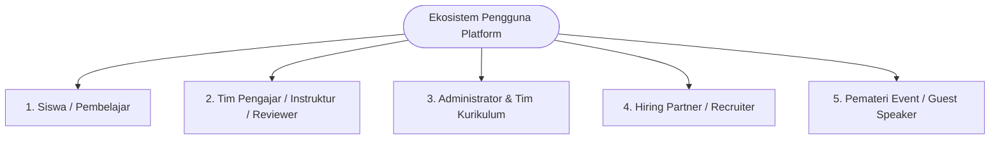
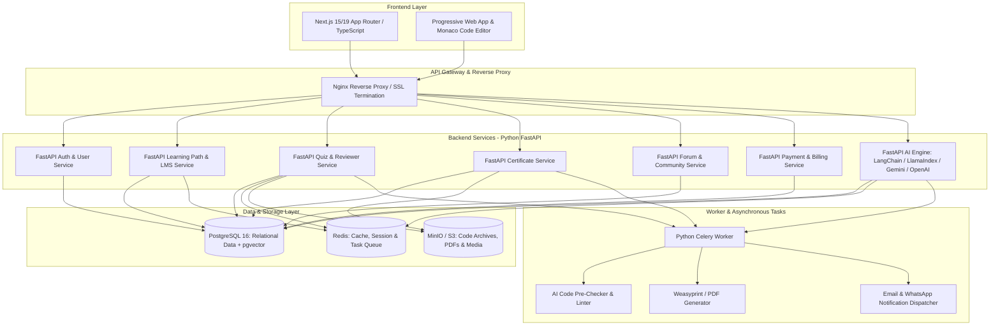

# Project Brief: Platform Learning Management System (LMS) Berbasis Kompetensi & Karir Digital

**Nama Proyek Tentatif:** Karsa Academy / Elevate LMS (Platform Edukasi Teknologi Berstandar Industri)  
**Dokumen:** Project Brief & High-Level Architecture  
**Tanggal:** 25 Oktober 2026  
**Status:** DRAFT - Final Review  
**Inspirasi Utama:** Dicoding.com, Coursera, Alura, LeetCode  

---

## 1. Ringkasan Eksekutif (Executive Summary)

Platform ini adalah ekosistem *Learning Management System* (LMS) modern terakreditasi industri yang dirancang untuk melahirkan talenta digital (software engineer, data scientist, cloud/devops engineer, AI specialist, UI/UX designer) siap kerja. 

Berbeda dengan LMS video konvensional yang pasif, platform ini mengadopsi model pembelajaran **Active Learning & Project-Based Assessment** ala Dicoding:
1. Kurikulum berjenjang terstruktur dalam **Learning Path** (Pemula, Menengah, Mahir/Advance).
2. Sistem validasi kompetensi riil melalui **Code & Project Submission** yang dinilai langsung oleh **Tim Pengajar & Code Reviewer profesional** dengan rubrik bintang 1–5 serta feedback baris per baris.
3. Kredensial digital bersertifikasi resmi yang dilengkapi **Public Verification Page** dan integrasi LinkedIn.
4. Integrasi ekosistem menyeluruh: **Event/Webinar, Artikel/Berita Teknologi, Showcase Portofolio, Jaringan Alumni, Ruang Diskusi Q&A Interaktif,** dan **Talent Hub** yang menghubungkan lulusan langsung ke *Hiring Partners*.

---

## 2. Latar Belakang & Analisis Peluang (Background & Market Gap)

| Masalah di Pasar Saat Ini | Dampak pada Pembelajar | Solusi Platform Ini |
|---|---|---|
| Mayoritas kursus online hanya berupa video pasif (video sharing berbayar). | Siswa hanya menonton (*tutorial hell*), tanpa validasi apakah kodenya benar, bersih, dan berstandar industri. | Evaluasi berbasis **Submission Proyek Mandiri** yang direview manual oleh *Expert Reviewer* per baris kode. |
| Kurikulum terfragmentasi dan membingungkan pemula. | Siswa bingung harus mulai dari mana dan skill apa yang berurutan. | **Learning Path Kuratif** yang memandu siswa dari nol (*Basic*) hingga mahir (*Advance/Specialist*). |
| Sertifikat online mudah dipalsukan dan tidak dipercaya HRD/Industri. | Nilai tawar sertifikat rendah di mata perekrut (*recruiter*). | **Sertifikat Berbasis Kredensial Unik** dengan QR code, verifikasi online instan, dan riwayat pengerjaan proyek. |
| Minimnya ruang interaksi langsung saat menemui kendala *error/bug*. | Siswa macet berhari-hari, kehilangan motivasi, dan *drop out*. | **Ruang Diskusi Kontekstual** per modul pelajaran dengan sistem *Upvoting*, kurasi *Best Answer*, serta pendampingan fasilitator. |
| Lulusan kesulitan mencari kerja dan industri kesulitan menyaring kandidat. | Talenta lulusan menganggur, portofolio tidak terstruktur. | **Automated Portfolio Showcase** & **Alumni Talent Pool** yang dapat diakses langsung oleh perusahaan mitra (*Hiring Partners*). |

---

## 3. Visi, Misi & Unique Selling Proposition (USP)

### 3.1 Visi
Menjadi platform akselerasi talenta digital nomor satu yang menghubungkan aspirasi belajar dengan kebutuhan industri nyata melalui standardisasi kurikulum berstandar global.

### 3.2 Misi
1. Menyediakan jalur belajar teknologi yang terstruktur, teruji, dan selalu diperbarui sesuai tren industri.
2. Mengembangkan standar evaluasi ketat melalui *Human Code Review* dan kuis komprehensif.
3. Membangun komunitas teknologi yang suportif melalui forum diskusi, seminar berkala, dan jejaring alumni.
4. Menjembatani lulusan berprestasi dengan peluang karir di perusahaan teknologi dan startup global.

### 3.3 Pilar Unique Selling Proposition (USP)
- **Human-in-the-Loop Code Review:** Setiap tugas akhir mahasiswa dibedah oleh praktisi industri dalam waktu maksimal 1x24 s/d 3x24 jam dengan feedback konstruktif.
- **Industry-Endorsed Learning Paths:** Bekerja sama dengan prinsipal teknologi (e.g. AWS, Google Cloud, Android, Microsoft) dalam penyusunan silabus.
- **Dual Credentialing:** Memberikan *Certificate of Completion* (syarat kuis & modul) dan *Certificate of Competence* (lulus submission proyek mandiri).
- **Gamified Progression:** XP, Badges, Daily Streaks, dan Leaderboard untuk menjaga retensi dan motivasi belajar harian.
- **Talent Bridge:** Profil siswa secara otomatis mengompilasi portofolio hidup (*living portfolio*) yang dapat dikurasi oleh perekrut.

---

## 4. Sasaran Pengguna (Target Audience & Personas)



1. **Siswa / Mahasiswa / Jobseeker (Learner):**
   - Ingin belajar dari nol atau *career switch* ke dunia teknologi.
   - Membutuhkan kurikulum yang terarah, arahan mentor, dan sertifikat kredibel untuk melamar kerja.
2. **Reviewer & Tim Pengajar (Instructor/Reviewer):**
   - Profesional industri yang menguji submission proyek, memberi masukan kode, dan membuat modul pembelajaran.
   - Membutuhkan sistem antrean review (*reviewer queue*), rubrik penilaian yang jelas, dan dashboard pelacakan insentif/honor.
3. **Platform Administrator & Akademik (Admin & Operations):**
   - Mengelola katalog kelas, jalur belajar, diskon/beasiswa, verifikasi sertifikat, serta performa reviewer.
4. **Perusahaan Mitra (Hiring Partner / Recruiter):**
   - Mencari talenta terverifikasi berdasarkan spesialisasi, skor submission, portofolio proyek, dan lokasi.
5. **Pembicara & Komunitas (Community Speaker):**
   - Mengisi seminar, workshop, webinar berkala untuk *knowledge sharing* dan *branding*.

---

## 5. Cakupan Fitur Utama (Core Modules Breakdown)

Berikut adalah 18 pilar modul terintegrasi yang mencakup **100% kapabilitas Dicoding.com** ditambah **8 Pilar Inovasi Terobosan** yang menjadikan platform ini jauh lebih unggul:

```
┌─────────────────────────────────────────────────────────────────────────────┐
│                   18 PILAR MODUL PLATFORM LMS NEXT-GEN                      │
├─────────────────────┬─────────────────────┬─────────────────────────────────┤
│ 1. Onboarding &     │ 2. Learning Paths & │ 3. Zero-Setup In-Browser IDE    │
│    Sistem Akun      │    Kurikulum        │    & Interactive Classroom      │
├─────────────────────┼─────────────────────┼─────────────────────────────────┤
│ 4. Kuis Otomatis &  │ 5. Dual-Engine      │ 6. Sertifikasi Digital Kripto   │
│    Cooldown Engine  │    Review (AI+Human)│    & Public Verification        │
├─────────────────────┼─────────────────────┼─────────────────────────────────┤
│ 7. Event, Webinar & │ 8. Coding Challenge │ 9. Poin Gamifikasi, RPG Skill   │
│    Developer Coaching    & Live Arena Bat.│    Tree & Reward Store          │
├─────────────────────┼─────────────────────┼─────────────────────────────────┤
│ 10. Beasiswa Massal │ 11. Blog Teknologi  │ 12. Showcase Portofolio &       │
│     & Token Cohort  │     & Media Wawasan │     Code Keystroke Replay       │
├─────────────────────┼─────────────────────┼─────────────────────────────────┤
│ 13. Alumni & Reverse│ 14. Ruang Diskusi   │ 15. Virtual Study Room 24/7     │
│     Hiring Talent   │     Kontekstual Q&A │     & Live Pair Programming     │
├─────────────────────┼─────────────────────┼─────────────────────────────────┤
│ 16. Tim Pengajar,   │ 17. AI Mock Job     │ 18. Monetisasi, Langganan Pass  │
│     Reviewer Guild  │     Interview Sim.  │     & B2B Enterprise Dashboard  │
└─────────────────────┴─────────────────────┴─────────────────────────────────┘
```

### 5.1 Modul 1: Pendaftaran, Otentikasi & Onboarding Terpersonalisasi
- **Registrasi Fleksibel:** Email + Password dengan konfirmasi aktivasi email, serta Social Login SSO (Google, GitHub, LinkedIn).
- **Onboarding Quiz & Minat:** Tes pemetaan minat dan asesmen kemampuan awal (pemula mutlak, menengah, berpengalaman) untuk merekomendasikan *Learning Path* yang tepat.
- **Profil Siswa Komprehensif:** Biodata, tautan GitHub/GitLab, akun LinkedIn, CV/Resume upload, serta portofolio URL.
- **Keamanan:** Multi-Factor Authentication (2FA), Session Manager, dan enkripsi data pribadi sesuai UU PDP No. 27/2022.

### 5.2 Modul 2: Learning Path & Kurikulum Berjenjang
- **Hierarki Kurikulum:** `Learning Path` ➔ `Kelas (Course)` ➔ `Modul (Module)` ➔ `Materi (Article/Video/Lab/Quiz/Project)`.
- **Level Kemahiran:**
  - *Pemula (Beginner / Dasar):* Pemrograman fundamental, sintaks dasar, tools setup, kuis interaktif.
  - *Menengah (Intermediate):* Penerapan best practices, API, database, arsitektur dasar, mini-proyek.
  - *Mahir (Advance / Expert):* Arsitektur berskala besar, clean code, automated testing, deployment/CI-CD, tugas akhir industri.
- **Alur Prasyarat (*Prerequisites*):** Penguncian kelas (*course lock*) sebelum kelas prasyarat diselesaikan dengan nilai minimum.
- **Perkiraan Waktu & Silabus Transparan:** Durasi belajar (dalam jam), materi yang dipelajari, software/hardware requirements.

### 5.3 Modul 3: Zero-Setup In-Browser Cloud IDE & Interactive Classroom (*Keunggulan vs Dicoding*)
- **In-Browser Cloud IDE (WebContainers):** Berbeda dengan Dicoding yang mewajibkan siswa menginstal compiler/environment rumit di laptop, siswa platform ini dapat langsung menulis, menjalankan server (Node.js/Python), dan mempratinjau aplikasi fullstack langsung di browser tanpa instalasi lokal!
- **Tipe Materi:**
  - *Rich Text & Interactive Code Snippets* (dengan syntax highlighting dan copy button).
  - *Video On-Demand Streaming* (multi-resolusi 360p–1080p, pengaturan kecepatan 0.5x–2x, bookmark catatan waktu).
  - *Voice-Assisted Code Explainer:* Fitur mendengarkan penjelasan logika baris kode yang disorot dengan suara AI berbahasa Indonesia yang alami.
- **Auto-Save & State Tracking:** Sistem menyimpan progres baris materi dan status latihan kode secara real-time.

### 5.4 Modul 4: Kuis Otomatis Berjenjang & Cooldown Engine
- **Kuis Pilihan Ganda Berjenjang:**
  - Soal acak (*randomized questions & options*), batasan waktu pengerjaan (*countdown timer*), ambang batas kelulusan (minimal 80%).
  - Kebijakan penalti waktu cooldown sebelum mencoba kembali jika gagal (30 menit, 2 jam, hingga 24 jam) untuk mencegah tebakan acak.

### 5.5 Modul 5: Dual-Engine Review (Instant AI Pre-Review + Human Expert Audit) (*Keunggulan vs Dicoding*)
- **Detik ke-10 (AI Pre-Review):** Begitu proyek diunggah (.zip atau GitHub), AI Engine langsung memindai struktur folder, menjalankan linter, security check, dan deteksi plagiarisme semantik via `pgvector`, menghasilkan laporan umpan balik seketika.
- **Waktu < 12 Jam (Reviewer Manusia):** Reviewer manusia menerima proyek yang sudah dilengkapi *AI Draft Checklist*. Reviewer fokus menguji arsitektur dan memberikan catatan personal dengan skala Bintang 1–5. Review selesai dalam < 12 jam (3x lebih cepat dibanding antrean Dicoding 1-3 hari).
- **Sistem Revisi:** Siswa berhak memperbaiki catatan reviewer hingga 3 kali kesempatan tanpa biaya tambahan.

### 5.6 Modul 6: Sertifikasi Digital Kriptografis & Public Verification
- **Dua Jenis Sertifikat:**
  1. *Certificate of Completion:* Diberikan setelah seluruh materi dan kuis selesai.
  2. *Certificate of Competence:* Diberikan hanya jika lulus submission proyek akhir dengan minimal Bintang 3.
- **Fitur Kredensial:**
  - ID Sertifikat Kriptografis Unik dengan tanda tangan digital SHA-256.
  - Halaman Verifikasi Publik (`https://domain.com/certificates/{cert_id}`) yang memuat rincian kompetensi, rating bintang, dan tautan live demo proyek.
  - Integrasi 1-klik "Add to LinkedIn Profile" dengan metadata terakreditasi.
  - Unduh PDF 300 DPI dengan QR code dinamis yang dapat diverifikasi instan oleh sistem ATS perusahaan.

### 5.7 Modul 7: Seminar, Workshop & Developer Coaching (Dicoding Event Equivalent)
- **Kategori Event:** Webinar Online, Tech Talk, Workshop Hands-on, Hackathon, Info Session Beasiswa.
- **Developer Coaching:** Sesi mentoring live mingguan interaktif via streaming eksklusif bagi siswa pelanggan aktif untuk bedah kode langsung bersama tim kurikulum.
- **Presensi & E-Sertifikat Otomatis:** Token presensi hanya aktif saat acara berlangsung, memicu penerbitan e-sertifikat kehadiran otomatis pasca pengisian survei feedback.

### 5.8 Modul 8: Coding Challenge & Live Arena Battles (Dicoding Challenge Equivalent + Inovasi Baru)
- **Corporate Coding Challenge:** Kompetisi membangun aplikasi tematik yang disponsori perusahaan/brand teknologi ternama dengan batas waktu dan hadiah uang tunai, gadget, atau kontrak kerja.
- **Weekly Live Coding Arena (Inovasi Baru):** Fitur pertarungan adu cepat memecahkan soal algoritma 1-on-1 (*live algorithmic battle*) antar siswa dengan leaderboard mingguan berhadiah XP dan lencana prestasi.

### 5.9 Modul 9: Poin Gamifikasi, RPG Skill Tree & Reward Store (Dicoding Points Equivalent + RPG Gamification)
- **Gamifikasi XP & Poin Belajar:** Poin diperoleh dari kelulusan kelas, daily streak belajar, kontribusi forum, dan kemenangan challenge.
- **RPG Visual Skill Tree (Inovasi Baru):** Visualisasi cabang keahlian siswa interaktif layaknya pohon keterampilan game RPG (misal: *Branch Frontend: CSS Grid (Mastered), State Management (Lv.3), Web Security (Unlocked)*).
- **Reward Store Catalog:** Penukaran poin dengan merchandise fisik eksklusif (hoodie, t-shirt, tumbler), buku teknologi, gadget (laptop, monitor, keyboard mekanikal), atau token voucher langganan kelas.

### 5.10 Modul 10: Program Beasiswa & Sistem Token Multi-Phase Cohort (IDCamp/Bangkit Equivalent)
- **Infrastruktur Beasiswa Massal:** Sistem penerbitan ribuan token aktivasi kelas untuk program kerja sama CSR, Kementerian/Pemerintah, dan Universitas.
- **Multi-Phase Cohort Engine:** Manajemen seleksi siswa bertahap (Tahap Dasar ➔ Tahap Menengah ➔ Tahap Mahir ➔ Fasilitasi Kelulusan & Capstone Project) lengkap dengan laporan analitik dampak program (*Impact Report*) bagi mitra sponsor.

### 5.11 Modul 11: Berita, Blog Teknologi & Editorial
- **Kategori Konten:** Tutorial Teknis, Berita Industri IT, Kisah Sukses Alumni (*Student Stories*), Tips & Trik Karir, Panduan Wawancara Kerja.
- **Fitur Pembaca:** Estimasi waktu baca (*read time*), pembagian ke media sosial, sistem apresiasi (*claps/likes*), dan komentar terindeks Google SEO.

### 5.12 Modul 12: Showcase Portofolio & Code Keystroke Replay (*Keunggulan vs Dicoding*)
- **Showcase Portofolio Otomatis:** Menampilkan proyek submission bintang 4-5 di galeri publik siswa lengkap dengan demo aplikasi dan repositori GitHub.
- **Code Keystroke Replay Player (Anti-Joki untuk Rekruter):** Rekruter dapat memutar ulang rekaman penulisan kode siswa di Cloud IDE dari nol untuk membuktikan keaslian proses berpikir dan pemecahan masalah (membuktikan bukan hasil joki atau copas).

### 5.13 Modul 13: Jaringan Alumni & Talent Hub (Reverse Hiring Portal)
- **Direktori Lulusan Terverifikasi:** Filter pencarian berdasarkan spesialisasi, rating submission bintang 4-5, kesiapan kerja (*Actively Looking*), dan domisili.
- **Reverse Hiring:** Perusahaan mitra (*Hiring Partners*) yang secara proaktif mengajukan undangan wawancara kerja dan penawaran gaji kepada profil siswa yang sesuai.

### 5.14 Modul 14: Ruang Diskusi Interaktif (Community Forum)
- **Diskusi Kontekstual Per Modul:** Tab diskusi tersemat di bilah samping materi pelajaran dengan integrasi syntax highlighting.
- **AI Semantic Deduplication:** Deteksi instan pertanyaan serupa menggunakan `pgvector` dan sistem pemilihan *Best Answer*.

### 5.15 Modul 15: Virtual Study Room 24/7 & Live Pair Programming (*Keunggulan vs Dicoding*)
- **Virtual Study Room (Study with Me):** Ruang belajar virtual 24/7 dengan pengatur waktu Pomodoro dan ambient lofi music untuk mengikis rasa kesepian saat belajar mandiri.
- **Collaborative Pair Programming:** Kemampuan dua siswa atau siswa bersama mentor membuka kanvas kode yang sama secara real-time (*multi-cursor live coding*) untuk memecahkan bug bersama.

### 5.16 Modul 16: Tim Pengajar & Reviewer Guild (Dicoding Elite Equivalent)
- **Reviewer Guild Dashboard:** Antrean tugas review berbasis keahlian teknis (FIFO) dengan penguncian klaim otomatis 3 jam.
- **Kompensasi Transparan:** Pelacakan otomatis saldo honorarium per review (Pemula Rp 15rb, Menengah Rp 35rb, Advance Rp 75rb-120rb) dengan audit sampling mutu review berkala.

### 5.17 Modul 17: AI Mock Technical Interview Simulator (*Keunggulan vs Dicoding*)
- **Simulasi Wawancara Kerja AI:** Sebelum lulus kelas Advance, siswa diuji oleh AI interviewer yang mensimulasikan sesi wawancara teknis perusahaan unicorn (live coding challenge, pertanyaan kompleksitas algoritma Big-O, dan pertanyaan behavioral).

### 5.18 Modul 18: Monetisasi, Langganan Pass & B2B Enterprise Dashboard
- **Model Akses:** Pembelian kelas tunggal (*pay-per-course*), langganan penuh (*Monthly/Annual All-Access Pass*), dan token beasiswa institusi.
- **Payment Gateway Lokal:** Virtual Account, QRIS, E-Wallet, Kartu Kredit 3DS, dan pembayaran minimarket.
- **B2B Enterprise Training Dashboard:** Portal khusus manajemen perusahaan untuk memantau jam belajar, skor submission, dan kurva keahlian tim karyawan.


---

---

## 6. Arsitektur Teknologi Terpilih: Python, Next.js & PostgreSQL + AI

Berdasarkan keputusan teknis, platform ini secara standar dibangun menggunakan triad teknologi modern: **Python (FastAPI)** di layer backend layanan & AI, **Next.js (React 19 / TypeScript)** di layer frontend antarmuka, serta **PostgreSQL (ACID + pgvector)** sebagai basis data utama.



### 6.1 Rincian Tech Stack Terpilih
- **Frontend Layer:** **Next.js (App Router, React 19, TypeScript)**
  - UI Styling: Vanilla CSS / Modern CSS Variables / Tailwind CSS dengan tema Dark/Light.
  - Interactive Code: Monaco Editor (VS Code engine in browser) untuk membaca dan mereview baris kode siswa.
  - State & Data Fetching: TanStack Query (React Query) + Zustand untuk lightweight state management.
- **Backend Layer:** **Python 3.12+ (FastAPI)**
  - Kecepatan tinggi (Starlette + Pydantic v2), dukungan async/await native, dokumentasi OpenAPI/Swagger otomatis.
  - ORM: SQLAlchemy 2.0 (Async) + Alembic untuk database migration terstruktur.
  - Background Tasks & Queue: Celery / Redis untuk pemrosesan antrean submission, kalkulasi embedding AI, dan render sertifikat PDF.
- **Database Layer:** **PostgreSQL 16+ dengan Ekstensi `pgvector`**
  - Penyimpanan data transaksional aman ACID (nilai siswa, transaksi pembayaran, otentikasi).
  - Ekstensi `pgvector` untuk pencarian semantik AI (*vector embeddings*): mencari solusi forum Q&A yang mirip, kurasi materi relevan, dan pencocokan kandidat alumni dengan kriteria rekruter.
- **Penyimpanan Berkas (Object Storage):** MinIO / AWS S3 / Cloudflare R2 untuk menyimpan berkas `.zip` submission siswa, gambar modul, dan arsip PDF sertifikat.

---

## 7. Ekosistem Kecerdasan Buatan (Antigravity AI Capabilities)

Integrasi AI pada platform ini bukan sekadar gimmick, melainkan dirancang sebagai **asisten akselerasi pembelajaran dan efisiensi operasional tim reviewer**:

```
┌─────────────────────────────────────────────────────────────────────────────┐
│                    4 PILAR KECERDASAN BUATAN (AI LMS)                       │
├─────────────────────┬─────────────────────┬─────────────────────────────────┤
│ 1. AI Coding Tutor  │ 2. AI Code Pre-Check│ 3. AI Forum Assistant           │
│    (In-Class Copilot│    & Reviewer Draft │    & Semantic Search            │
├─────────────────────┴─────────────────────┴─────────────────────────────────┤
│ 4. AI Talent Matchmaker & Portfolio Analyzer (Hiring Partner)               │
└─────────────────────────────────────────────────────────────────────────────┘
```

1. **AI Coding Tutor (In-Classroom Socratic Assistant):**
   - Siswa dapat membuka panel asisten AI saat membaca materi atau melihat kode.
   - Menggunakan pendekatan *Socratic Questioning*: AI **tidak memberikan kode solusi jadi secara langsung**, melainkan memandu logika siswa, menerjemahkan arti pesan error (*stack trace debugging*), dan memberikan analogi konsep pemrograman.
2. **AI Submission Pre-Reviewer & Quality Co-pilot:**
   - Saat siswa mengunggah berkas proyek `.zip` atau link GitHub:
     - AI mengekstrak kode, menjalankan analisis statis (linting, anti-plagiarism semantic similarity via pgvector), dan mendeteksi kerentanan keamanan dasar (misal: hardcoded API keys).
     - AI secara otomatis menyiapkan **Draft Review Summary** untuk reviewer manusia (misal: "Kriteria 1-4 terpenuhi, ada potensi memory leak pada baris 45 file order.ts").
     - **Reviewer manusia menghemat waktu hingga 40%**, sehingga turnaround time review bisa turun ke < 12 jam!
3. **AI Forum Assistant & Semantic Deduplication:**
   - Saat siswa mengetik pertanyaan baru di forum modul, AI menggunakan `pgvector` untuk mencocokkan pertanyaan tersebut dengan ribuan diskusi terdahulu yang sudah terpecahkan (*Best Answer*).
   - Jika belum ada jawaban dalam 15 menit, AI memberikan respon pertolongan pertama terverifikasi dengan rujukan dokumentasi resmi.
4. **AI Talent Matchmaker (Hiring Hub):**
   - Menganalisis repositori tugas akhir siswa, riwayat nilai submission, dan proyek portofolio untuk dipetakan ke dalam profil kompetensi.
   - Membantu *Hiring Partners* mencocokkan deskripsi lowongan kerja (*Job Description*) dengan profil alumni yang paling relevan.

---

## 8. Rencana Tahapan Rilis (Roadmap & Milestones)

| Fase | Durasi | Target Utama / Deliverables |
|---|---|---|
| **Fase 1: Minimum Viable Product (MVP Core)** | Bulan 1 – 2 | - Sistem Otentikasi & Registrasi (Email & Google SSO).<br>- Backend Python FastAPI & Database PostgreSQL.<br>- Frontend Next.js Web Portal & Reader Interaktif.<br>- Kuis Otomatis Pilihan Ganda.<br>- Payment Gateway dasar (Beli kelas tunggal). |
| **Fase 2: Code Review Engine, Sertifikasi & AI Pre-Review** | Bulan 3 – 4 | - Sistem Upload Submission Proyek (.zip / GitHub).<br>- Celery Worker untuk Automated Linter & AI Pre-Review draft.<br>- Reviewer Portal (Antrean FIFO, Rubrik Bintang 1-5, Inline Feedback).<br>- Digital Certificate Generator (PDF Weasyprint + Halaman Verifikasi Publik).<br>- Forum Diskusi Kontekstual per Modul. |
| **Fase 3: AI Coding Tutor, Event & Monetisasi Lanjutan** | Bulan 5 | - Integrasi AI Socratic Coding Tutor di ruang kelas interaktif.<br>- AI Semantic Search di Forum Diskusi dengan `pgvector`.<br>- Modul Event & Seminar (Pendaftaran, Tiket, Presensi).<br>- Blog Teknologi & Berita Industri.<br>- Model Langganan (Subscription Billing bulanan/tahunan). |
| **Fase 4: Talent Hub, AI Matchmaker & Enterprise** | Bulan 6+ | - Showcase Portofolio Siswa Terverifikasi.<br>- Portal Hiring Partner dengan AI Job Description Matching.<br>- Dashboard Perusahaan / Beasiswa B2B (Laporan progres belajar karyawan).<br>- Mobile App / Advanced PWA. |

---

## 9. Ringkasan Dokumen Pendukung Terkait
Dokumentasi lengkap untuk spesifikasi bisnis dan produk telah dipisahkan ke dalam berkas standar industri berikut:
- **[BRD.md](file:///Users/kerasakti/Documents/LMS/BRD.md):** *Business Requirements Document* (Model bisnis, ROI integrasi AI, SLA review, aturan bisnis, dan kepatuhan UU PDP).
- **[PRD.md](file:///Users/kerasakti/Documents/LMS/PRD.md):** *Product Requirements Document* (Rincian user stories Gherkin, AI endpoint contracts, ERD PostgreSQL + pgvector, dan arsitektur FastAPI + Next.js).

